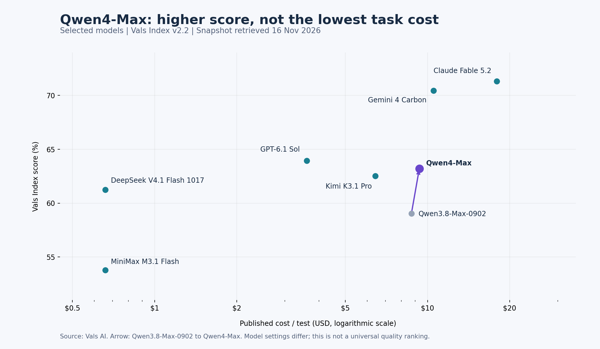

# Qwen4 系列深度研究：Max 的能力、价格、速度与三年竞争力

> 研究日与资料截止日：2026 年 11 月 16 日，北京时间。Qwen4-Max 当日正式发布；本文是发布日研究版本。
>
> 方法：核对官方发布、产品规格和价格，并用独立评测机构的原始结果交叉判断。未调用付费推理 API，未进行本人实测。所有速度数字均注明外部测试口径，三年情景为作者判断。

## 一、先给结论：这是值得测试和部署的重要升级，但优势并不覆盖所有任务

**Qwen4-Max 最有说服力的变化，是在提升任务能力的同时改善计算和执行效率。它进入了国内领先的通用工作模型行列，但现有证据不足以把它称为全球最强、最快或实际使用最便宜的模型。**

三个结果最能说明问题：

| 要回答的问题 | 发布日证据 | 判断 |
|---|---|---|
| 比上一代强多少？ | Vals Index 从 Qwen3.8-Max-0902 的 59.05% 升至 63.20%，增加 4.15 个百分点 | 综合进步明确，仍有细分任务退步 |
| 做任务是否更省钱？ | 同一机构的 Terminal-Bench 4.0 成本从 12.15 美元降至 3.90 美元；Vals 综合测试成本却从 8.73 美元升至 9.33 美元 | 节省程度高度依赖任务、推理设置和缓存，不能只看单价 |
| 是否更快？ | Vals 综合耗时从 105 分 46 秒降至 64 分 39 秒；GPT-6.1 Sol 对应为 44 分 24 秒 | 对自身上一代明显改善，但并非跨厂商速度领先 |

来源：[S07][S08][S09][S10][S13]。上述成本和耗时是评测机构定义的指标，不等于普通聊天一次请求的费用或等待时间。

从模型选型角度，我会把它放进复杂中文业务、图文材料处理、多步骤办公和通用 Agent 的第一轮候选名单；对终端编程、极低成本高并发、实时交互，则应同时测试各自更有优势的竞品。对已有 Qwen3.8-Max 用户，也应按业务回归结果迁移。

**站在 2029 年回看，今天这一版 Qwen4-Max 本身很可能已经不是前沿生产首选。更可能留下价值的，是这一代验证的效率路线、开发者生态，以及围绕真实工作形成的数据、工具和评估体系。Qwen 系列能否持续领先，与阿里能否把领先转化成利润，是两个需要分别验证的问题。**

## 二、先把“Qwen4 系列”说清楚

截至研究截止日，可确认的正式发布重点是 **Qwen4-Max**。官方表示后续会推出较小的开放权重模型，但不能据此写出尚未确认的 Qwen4-Plus、Flash、具体参数档位、许可证和上线日。[S01]

| 对象 | 截止日状态 | 本文如何处理 |
|---|---|---|
| Qwen4-Max 正式版，API ID `qwen4-max` | 已正式发布；有按量计费与产品文档 | 核心研究对象 |
| `qwen4-max-preview` | 限时预览渠道；预览文档规定可用期为 11 月 11 日至 11 月 25 日，仅面向 Token Plan | 单独识别，不把预览优惠和限制套到正式版 |
| Qwen4 后续较小模型 | 官方预告，完整规格与发布时间尚未核实 | 讨论潜在影响，不编造产品清单 |
| Qwen3.8-Max / `qwen3.8-max-0902` | 上一代正式模型与更新版本 | 性能比较优先使用明确标注的 0902 版本 |
| Qwen3.8-Flash-Next | 已公开的实验性架构模型 | 用于理解技术路线；不冒充 Qwen4-Max 开放权重版 |

来源：[S01][S02][S03][S05][S06]。

正式版文档给出的核心边界是：支持文本、图片、视频理解，生成文本；上下文为 1,000,000 token，非思考最大输出 131,072 token，思考与最终回答合计上限 262,144 token。它支持函数调用、结构化输出及缓存；当前产品文档明确不支持模型调优、自行部署和批量推理。[S02]

这里有两个常见误读。首先，**100 万上下文、长输出上限和可输入图片视频，都是接口容量或功能，不等于模型能可靠用好整个窗口，也不等于能直接生成音视频。**其次，Qwen 系列存在开放模型，不代表 Max 权重已经开放、可私有化部署。

发布日文档尚有同步差异：Preview 文档及部分聚合商仍展示 393,216 等输出上限；本文采用正式版规格页的 262,144 合计上限，不混用。Vals 把模型日期记为 11 月 15 日，本文以 Qwen 官方北京时间 11 月 16 日发布记录为准；不把两者视为两个正式型号。[S01][S02][S03][S09]

## 三、与上一代相比，真正重要的变化是什么？

### 3.1 主干没有继续变大，激活计算明显收缩

Qwen 官方披露，Qwen4-Max 保留 2.4T 主干参数规模，每 token 激活参数为 71B；另有 328B 的 N-gram Embedding 参数。Qwen3.8-Max 的主干同为 2.4T，激活参数为 95B。因此，本代每 token 激活参数减少约 **25.3%**。2.4T 主干和额外嵌入参数应分开理解，不能写成“一个每次都计算 2.4T 参数的稠密模型”。[S01][S05]

这一变化的意义在于：模型容量可以继续很大，而实际生成一个 token 时，不必让全部容量参与计算。但激活参数下降不意味着实际算力费用、显存占用和端到端延迟也按同一比例下降。内存访问、专家通信、注意力、并发利用率与服务策略仍然会影响成本。

### 3.2 架构升级集中在长上下文效率与信息传递

官方描述的三项关键设计如下；相近技术已在 Qwen3.8-Flash-Next 中预览，本代的重要性在于把路线推进到 Max 规模。[S01][S06]

| 设计 | 可核实的机制 | 作者判断：可能解决什么 | 尚不能据此证明什么 |
|---|---|---|---|
| Gated DeltaNet + Qwen Sparse Attention | 每三个 GDN 层配一个 QSA 层；用状态压缩与稀疏选择处理历史 | 降低长序列处理负担，为长任务腾出计算预算 | 不保证长文档任意位置的信息都无损保留 |
| Gated Residual | 四条残差分支通过门控传递信息 | 改善深层网络的信息流和训练稳定性 | 没有公开完整消融，不能量化它独自贡献多少分 |
| N-gram Embedding | 通过局部模式查表补充表示 | 将部分常见模式处理交给更便宜的存储与检索 | 参数增加不等于同比例增加通用推理能力 |

这更像是一次计算预算分配方式的升级：把有限计算用于更值得推理的部分。对于企业，它的最终价值应体现在相同服务质量下能处理更多业务，而不是架构名称本身。

### 3.3 能力增量主要表现为更好的工作执行，部分能力并非首次出现

原生视觉和百万上下文在上一代就存在。本代应验证的是图表理解、文档综合、工具使用和长任务交付质量有没有提高，而不是把已有功能重新算作突破。[S05][S02]

官方自建 Work360 的分数由 47.74 升至 52.69；官方报告在相同 effort 档位下，Work360 的 token 用量减少约 24%—35%，Terminal-Bench 4.0 减少约 48%—49%。这些是特定评测、特定设置下的结果，不能推导为任意任务都少用一半 token。[S01]

值得关注的产品变化，是让任务先形成可查看的交付物，再根据反馈继续修订。官方 Live Delivery 插件已经公开，并能在 Codex 环境中使用配置好的模型。**它说明模型与执行系统共同设计的重要性，也说明这种交付机制不是只有 Qwen4 权重才能拥有的独占能力。**[S20]

本次材料没有提供足以复现 Max 的完整训练配方、训练总成本和组件消融。可以判断整体效果变好，不能把它精确归因于某一种未公开的强化学习算法，也不能根据低报价直接判断阿里的推理毛利率。

## 四、效果横评：国内领先有证据，全球全能领先没有证据

### 4.1 先看独立的综合工作评测

Vals Index v2.2 汇总金融、编程、法律和税务任务，按相关行业在美国 GDP 中的权重构成指数。它适合观察一部分专业工作的表现，但并不覆盖所有中文企业任务、创作体验、实时语音和模型安全性。[S07]

下表为发布日读取的同一榜单快照。费用和耗时均保留 Vals 定义；不同模型的推理档位、输出预算并不完全相同，因此这是“各自配置下的产品表现”，不是严格的同算力架构实验。

| 模型 | Vals 分数，% | 成本/测试，美元 | 耗时/测试 |
|---|---:|---:|---|
| Claude Fable 5.2 | 71.31 | 17.94 | 43 分 42 秒 |
| Claude Sonnet 5.5 | 70.85 | 16.18 | 约 86 分钟 |
| Gemini 4 Carbon | 70.45 | 10.51 | 47 分 45 秒 |
| Claude Opus 5.5 | 70.14 | 24.77 | 约 85 分钟 |
| GPT-6 Astra | 65.02 | 21.28 | 33 分 39 秒 |
| GPT-6.1 Sol | 63.94 | 3.61 | 44 分 24 秒 |
| **Qwen4-Max** | **63.20** | **9.33** | **64 分 39 秒** |
| Kimi K3.1 Pro | 62.52 | 6.44 | 63 分 36 秒 |
| DeepSeek V4.1 Flash 1017 | 61.26 | 0.66 | 39 分 55 秒 |
| GLM 5.3 | 59.85 | 8.52 | 约 64 分钟 |
| Hy4 | 59.35 | 1.72 | 51 分 31 秒 |
| Qwen3.8-Max-0902 | 59.05 | 8.73 | 105 分 46 秒 |
| MiMo V2.6 Pro | 57.81 | 0.43 | 约 73 分钟 |
| Step 5 Preview | 54.76 | 2.73 | 约 65 分钟 |
| MiniMax M3.1 Flash | 53.78 | 0.66 | 43 分 18 秒 |

来源：[S07]；Qwen 新旧版本、Kimi 的精确时长来自对应模型页 [S09][S10][S14]。这是一组不同定位产品，不能把 Flash 与旗舰的价格差直接当成同能力折扣。

图中纵轴为 Vals 综合分数，横轴为该机构公布的测试成本，采用对数刻度；箭头连接 Qwen 新旧两代。左上方向代表该测试中的较高分数与较低费用，不代表所有场景的最优选择。

这组结果支持四个判断：

1. **Qwen4-Max 已进入国内第一梯队。**在此快照中，它在已测中国模型中分数最高。但 Qwen 的 63.20% 与 Kimi 的 62.52%、Sol 的 63.94% 距离很近。三者报告的标准误分别约为 1.01、1.14、1.07 个百分点，不能仅凭不足一个百分点的差距认定稳定胜负，更不能把这些标准误当作已经完成的配对显著性检验。[S09][S13][S14]
2. **距离领先海外模型仍有明显差距。**Fable、Sonnet、Opus 与 Gemini Carbon 在这组综合任务中均达到约 70 分或以上。不能把“国内分数最高”改写为“全球最强”。
3. **Qwen 的 token 单价低于 Sol，不代表实际完成同类工作更便宜。**该评测中 Sol 的分数接近，成本和时间却都更低。这是需要在自己的任务中重点复核的竞争压力。
4. **低价模型在大规模业务中构成另一条压力。**DeepSeek 与 MiniMax 的单位费用很低，即使某些任务分数不如 Max，也可能在通过业务验收的子任务上占优。是否可替代，应看失败与人工复核成本。

### 4.2 编程必须拆成不同任务来看

| 模型 | Terminal-Bench 4.0，% | 成本/测试，美元 | 耗时/测试 |
|---|---:|---:|---|
| Claude Fable 5.2 | 65.15 | 14.56 | 55 分 07 秒 |
| Claude Opus 5.5 | 65.15 | 12.04 | 约 64 分钟 |
| Kimi K3.1 Pro | 63.64 | 4.57 | 49 分 21 秒 |
| Gemini 4 Carbon | 63.13 | 7.45 | 45 分 07 秒 |
| GPT-6.1 Sol | 55.05 | 1.72 | 45 分 12 秒 |
| **Qwen4-Max** | **48.48** | **3.90** | **约 75 分钟** |
| Qwen3.8-Max-0902 | 38.89 | 12.15 | 约 143 分钟 |
| DeepSeek V4.1 Flash 1017 | 31.82 | 0.54 | 41 分 10 秒 |
| MiniMax M3.1 Flash | 25.25 | 0.73 | 50 分 31 秒 |

来源：[S08]，这些行均标注使用 Mini-SWE-agent。分数、价格和时长不能与另一种 harness 下的成绩直接拼接。

在这个终端任务集合中，Qwen 相对上一代提高 **9.59 个百分点**，成本降低 **67.9%**，按榜单取整时间计算耗时缩短约 **47.6%**。这一进步很大；同时，Kimi、Claude、Gemini 与 Sol 的结果说明，它仍不是高难终端任务的领先者。

前端网页偏好评测给出不同侧面：Arena Code/WebDev 中，Qwen4-Max 为 1750 Elo，Qwen3.8-Max-0902 为 1676，Sol 为 1742，Opus 为 1816。Qwen4 条目仍标注 preliminary，区间约为 ±15；不能把它领先 Sol 的 8 个 Elo 点说成确定的能力优势，也不能把 Elo 增长换算成质量增长百分比。[S11]

因此，“能做出让人满意的网页”“能修改真实仓库”“能在终端解决复杂环境问题”“能长期维护大型系统”，应拆成不同验收集。单个漂亮演示无法代表完整的软件工程能力。

### 4.3 不应遗漏的退步：法律、税务与金融并不是一起上升

| Vals 子项 | Qwen3.8-Max-0902，% | Qwen4-Max，% | 应如何解释 |
|---|---:|---:|---|
| Finance Agent v2.1 | 58.83 | 66.68 | 金融代理任务的改善较明显 |
| Vals Finance Index | 61.66 | 61.99 | 金融综合指标只小幅上移，不能概括为全面大涨 |
| Legal Research Bench | 46.15 | 41.35 | 点估计下降，需针对法律研究做回归检查 |
| Tax Agent Bench | 49.66 | 40.35 | 点估计下降，不能默认新版全面替代旧版 |
| Vibe Code Bench v1.1 | 77.14 | 86.66 | 代码生成相关任务提升 |

来源：[S09][S10]。这些是各自测试配置下的点估计；未取得逐题配对结果，不能将所有升降都解释成统计显著变化，更不能归因于某个训练模块。美国法律税务测试也不直接代表中国业务适用性。

新版本上线应保留旧模型对照和回滚路径。尤其不能因为综合榜上涨，就撤掉法律、合规、财务等专业流程已有的人审和证据核验。

### 4.4 多模态与高难推理：官方数据支持进步，也保留了短板

官方发布的横评中，Qwen4-Max 在 Chartography 为 54.2，较上一代 42.0 提高，但低于 GPT-6 Astra 的 71.1；HLE 为 51.7，较上一代 43.9 提高，低于 Opus 5.5 的 59.8。这些是官方横评口径，不能视为本文实测，表中也未覆盖所有截止日最新竞品。[S01]

我对多模态的判断是“能力提高，仍须逐场景验收”。长视频定位、复杂表格、跨页证据合并、细小文字和多图冲突处理，可能有完全不同的失败模式。支持百万上下文不能替代这些测试。

目前还缺少足够的独立中文行业任务结果、长文档不同位置召回曲线、持续多小时运行的失败率以及稳定性复测。这些缺口决定了报告只能支持选型候选判断，不能替代上线验收。

## 五、价格：单价下降是真的，“任务成本都下降”不成立

### 5.1 中国站人民币价格

单位为人民币元/百万 token，按官方按量报价；输出包含计费的思考与最终回答。以下不混入 Token Plan 订阅权益。[S04]

| 价格项目 | Qwen3.8-Max / 0902 | Qwen4-Max |
|---|---:|---:|
| 普通输入 | 12 | 10 |
| 输出 | 36 | 30 |
| 隐式缓存读取 | 1.5 | 0.5 |
| 显式缓存创建，默认档 | 15 | 12.5 |
| 显式缓存读取 | 1 | 0.5 |

新旧输入和输出单价均下降 **16.7%**；隐式缓存读取下降 **66.7%**。Qwen4 的默认显式缓存创建档为 5 分钟，1 小时档创建费用另为 20 元/百万 token，不能用 12.5 元覆盖所有保存时间。[S04][S19]

### 5.2 国际美元报价：与国内价格分开，不做任意汇率换算

QwenCloud 国际部署口径为输入 1.50、输出 4.50 美元/百万 token；上一代对应为 2.00、6.00，均下降 **25%**。其他部署区域有不同价格，不应混成一个“全球统一售价”。[S15]

下表比较文本输入、常规在线按量价格。统一金额算例假设 **10 万未缓存输入 token + 1 万总输出 token**，不含搜索、工具、重试、税费或优惠券。

| 模型/路由 | 输入，美元/百万 token | 输出，美元/百万 token | 等 token 算例，美元 | 主要口径 |
|---|---:|---:|---:|---|
| **Qwen4-Max** | **1.50** | **4.50** | **0.195** | 国际部署 [S15] |
| Qwen3.8-Max-0902 | 2.00 | 6.00 | 0.260 | 同一国际部署 [S15] |
| GPT-6.1 Sol | 2.00 | 10.00 | 0.300 | 常规模式、未触发长输入加价 [S16] |
| Claude Fable 5.2 | 8.00 | 40.00 | 1.200 | 标准报价 [S17] |
| Claude Opus 5.5 | 4.00 | 20.00 | 0.600 | 标准报价 [S17] |
| Claude Sonnet 5.5 | 2.00 | 10.00 | 0.300 | 标准报价 [S17] |
| Gemini 4 Carbon，当前促销 | 2.00 | 10.00 | 0.300 | 截至 2026-11-30 [S18] |
| Gemini 4 Carbon，公告恢复价 | 4.00 | 20.00 | 0.600 | 自 2026-12-01 起 [S18] |
| Kimi K3.1 Pro | 2.00 | 10.00 | 0.300 | Vals 模型页记录，非本次取得的官方完整价表 [S14] |
| GLM 5.3 | 1.40 | 4.40 | 0.184 | Z.AI 直连报价 [S21] |
| DeepSeek V4.1 Flash，忙时 | 0.30 | 1.20 | 0.042 | 官方直连，非云平台转售 [S22] |
| DeepSeek V4.1 Flash，闲时 | 0.15 | 0.60 | 0.021 | 按官方时段规则 [S22] |
| MiniMax M3.1 Flash | 0.15 | 0.60 | 0.021 | 官方直连 [S23] |

算式为 `0.1 × 输入单价 + 0.01 × 输出单价`。它只衡量等 token 的账单：各家分词、思考长度、工具轮次和失败重试不同，**等 token 不等于等工作量，更不等于等质量**。视觉输入还需按各家图像或视频计费规则核算。

这说明 Max 在旗舰报价中有竞争力，但在极低成本模型面前没有绝对价格优势。相反，便宜模型若要多次重试或需要更多人审，也可能丢掉账面优势。

### 5.3 缓存可能比模型单价变化更影响实际账单

假设一个固定 10 万 token 的公共前缀，在有效期内被连续使用 20 次，仅计算这部分输入费用：

- 不使用缓存：`20 × 0.1 × 10 = 20 元`。
- Qwen4 的 5 分钟显式缓存：第一次创建 `0.1 × 12.5`，其后 19 次命中各付 `0.1 × 0.5`，合计 **2.20 元**。
- 在这些假设下节省 **89%**。实际需要加上不同的用户输入、输出及工具费用。[S04][S19]

这不是对真实账单的承诺。前缀必须一致，缓存要在有效期内且满足接口要求；隐式缓存不保证命中。如果业务把时间戳、随机内容、每轮变化的用户材料放在共享前缀之前，或者调用间隔跨过有效期，节省可能大幅下降。

对于系统提示词、工具定义和固定业务手册很长的 Agent，这种工程优化可能比把输入价格再压低一点更有用。需要同时观察缓存命中率与正确性，不能为了命中缓存保留已经过时的政策和数据。

### 5.4 官方“任务成本下降”的数字为什么不能照搬？

官方英文 Work360 示例从 4.43 降至 1.67 美元，约降低 62%；官方中文发布材料为 26.58 降至 11.16 元，约降低 58%。两组数字涉及不同计价口径，不应强行用一个汇率拼成完全一致的数据。[S01][S24]

更关键的是独立测试给出不同方向：终端任务成本下降约 68%，综合工作测试成本却增加约 7%。原因可能涉及任务组合、输出预算、推理策略、缓存和测试版本；公开材料不足以精确拆分每个因素的贡献。

企业真正应优化的指标是：

**每个验收通过任务的总成本 =（全部尝试的 API 费 + 工具与基础设施费 + 人工审核及返工成本）÷ 验收通过的任务数。**

这里的分母是实际验收结果。不能直接用一个混合基准分数当作真实业务成功概率，再机械地计算“每次成功成本”。

## 六、速度：已证明任务耗时下降，尚未证明 token/s 或在线延迟领先

“快”至少有四种不同含义，必须分开测量：

| 指标 | 它反映什么 | 本次掌握的证据 |
|---|---|---|
| 首 token 延迟，TTFT | 服务开始流式响应的等待 | 未取得可比的独立数据 |
| 首段用户可读答案延迟 | 扣除或包含内部思考后，用户何时看到有用内容 | 未取得统一测法数据 |
| 解码速度，token/s | 开始生成后持续吐出 token 的速率 | 未取得足以横比的可信值；不填写估计数 |
| 完整任务完成时间 | 推理、工具调用、等待、重试与交付的总时长 | Vals 和 Arena 有外部测量，但任务与配置不同 |

Vals 综合任务中，Qwen 新版耗时缩短约 **38.9%**；终端任务约缩短 **47.6%**。前者用模型详情页秒级数值计算，后者用榜单取整分钟数计算，精度不同。[S08][S09][S10]

然而，在另一个实务来源 Arena Agent 中，Qwen4-Max xhigh 的任务时长 P50 为 15.7 分钟，Sol max 为 9.3 分钟，Gemini Carbon high 为 9.6 分钟。这些是真实任务分布、档位和服务条件混合后的观察，不能当成配对测速，但足以说明“Qwen4 必然最快”的结论没有依据。[S12]

架构效率提高、token 变少、云端总吞吐提高与单个用户更快看到答案，有时相关，也可能彼此背离。例如推理变得更积极，可能让高难任务成功率提高，却增加首段可读答案等待；更高的服务并发也可能改善资源利用但恶化尾部延迟。

在实际应用中，我会先测试 `high`，让 `xhigh` 处理少数确实需要深度推理的任务，并对低风险交互尝试 `low` 或关闭思考。档位名称在不同供应商之间没有统一算力含义，最终应以质量、P50/P95 延迟和费用一起验收。[S02]

## 七、竞争格局：Qwen4-Max 面临的不是同一种对手

以下定位是对前述测试和价格的综合判断，不是厂商的官方市场份额结论。

| 竞争对象 | 对 Qwen4-Max 构成的主要压力 | 什么情况下 Qwen 更值得选 |
|---|---|---|
| Claude Fable / Opus / Sonnet | 专业工作与高难编程表现强；部分任务时间也短 | Qwen 达到验收标准，且成本、接入和业务适配带来优势 |
| GPT-6.1 Sol；GPT-6 Astra | Sol 在本次综合工作测试中接近的分数配合较低任务成本；Astra 在部分高难任务更强 | 自己的中文、视觉或工具任务上 Qwen 获得更好结果，不能只凭 token 单价决定 |
| Gemini 4 Carbon | 综合分数、终端任务和部分视觉能力形成压力；当前存在促销 | 业务无需其差异化能力，Qwen 的落地与成本更合适；要按恢复价格复算长期预算 |
| Kimi K3.1 Pro | 综合水平接近，终端任务结果更强 | Qwen 在具体办公、文档和工具流程上通过对照胜出 |
| DeepSeek V4.1 Flash | 低价格与不错的综合能力，有利于高频任务 | Max 的额外可靠性或复杂任务能力能显著降低返工 |
| GLM 5.3 | 单价接近，形成国内同档产品替代选择 | Qwen 的能力差异在自有验收集上可重复，并覆盖迁移成本 |
| MiniMax M3.1 Flash | 低成本路线，对大量简单或受约束任务有吸引力 | 任务复杂度足以让 Max 的额外费用产生回报 |
| Hy4、MiMo V2.6 Pro、Step 5 Preview 等 | 进一步增加可替代性，压缩“仅凭通用模型接口”维持溢价的空间 | 按任务分层比较，避免把综合榜变成永久供应商名单 |

对豆包、文心等其他国内产品，本文未取得足以与上述同版模型逐项对齐的最新公开数据，因此不编造名次。国内竞争覆盖不完整，也是后续更新项。

Qwen 的潜在强项，是把旗舰能力、较小模型、开发工具和部署服务组合成一个可持续采用的体系。但未来 Qwen4 小模型的实际能力、开放方式与部署经济性尚未落地，当前不能把生态潜力全部计入 Max 的既成优势。

## 八、站在三年后：2029 年应该怎样评价这一代？

### 8.1 先区分三个对象，避免把“模型好”直接推成“商业一定成功”

**今天这一版权重。**我的判断是，到 2029 年，大多数追求前沿质量和成本效率的新项目会优先选择后续模型。少数需要版本冻结、审计一致性或特定行为的流程可能继续使用旧版，但它是否仍提供服务，要看供应商的版本政策。本文无法确认正式版三年后的服务期限。

**Qwen 作为持续迭代的模型系列。**本次结果显示，它具备在降低激活计算时提高任务水平的能力，这有利于下一轮竞争；但对全球领先模型的若干差距、细分任务回退、低价对手压力仍然存在。一次发布不能证明未来三年的研发位置。

**阿里的商业回报。**模型被使用可以带来收入机会，但回报还受价格竞争、算力成本、客户留存和应用价值归属影响。如果客户只把接口当成可随时替换的组件，能力领先也不必然形成很高利润；如果客户将持续工作流程建立在其平台上，价值捕获的可能性才更大。这里是商业机制推演，不是对阿里未来利润的数值预测。

### 8.2 三个情景：重点看可观察的条件

下列权重是作者用于组织判断的主观假设，合计 100%，不来自统计模型。

| 2029 年情景 | 主观权重 | Qwen 系列可能的位置 | 对这一代 Max 的回顾 | 哪些证据会支持它 |
|---|---:|---|---|---|
| 基准：持续处于国内领先阵营，全球多家竞争 | 55% | 若干工作任务有竞争力，部分高难任务仍需外部前沿模型 | 是效率与工作交付的重要过渡版本，后续模型逐步替代 | 多个版本持续改善质量与单位验收成本；客户保留多模型策略 |
| 上行：能力持续追平，平台形成客户留存 | 25% | 不仅通用能力强，企业任务也形成稳定优势 | 是从模型供应走向工作平台的关键一代 | 独立评测与私有任务都缩小差距；客户复购和工作流迁移成本同步提高 |
| 下行：能力趋同，价格与生态优势难以转成收益 | 20% | 仍是重要供应商，但份额与利润受到挤压 | 是一次不错的发布，商业贡献被后续竞争稀释 | 同质量任务被低价模型承接；高价值场景持续选择其他平台 |

不应把“2029 年单 token 更便宜”直接等同于“企业 AI 支出更少”。如果模型承担更长任务、调用更多工具、处理更多资料，总预算仍可能增长。应该观察相同验收标准下完成一个任务所需的成本。

为了说明敏感性，假设今天这项成本指数为 100，未来三年每年分别下降 15%、40% 或 60%，三年后指数约为 **61.4、21.6 或 6.4**。这是算术情景，不是对 Qwen 报价的预测；它说明应用方案需要能随成本变化升级，而不应按今天的价格永久锁死设计。

### 8.3 什么能力可能成为标配，什么仍然稀缺？

我的基准判断是，基本工具调用、长上下文、常规文档生成、标准代码任务和图文理解会进一步普及。仅靠接入一个模型、写一段提示词的差异化将减弱。这个判断的依据，是本次横评已经存在多家能力接近但价格和实现不同的供应商，而不是假定所有技术问题都会自动解决。

相对更难替代的部分包括：

- **可验证的行业结果。**能否正确完成真实业务，并有明确验收，而不只是文本看起来专业。
- **持续更新的数据与反馈。**知道任务为何失败、如何修复，以及新版模型在哪些分布退步。
- **工具权限和可靠执行。**在真实系统中安全地完成操作、恢复中断、检查结果和追溯责任。
- **用户信任与流程嵌入。**用户是否愿意持续交付重要工作，团队是否能在模型更换后保持质量。

因此，对应用开发者来说，与 Qwen4-Max 一同建设的评估集、工作流程、业务数据和纠错机制，可能比绑定这个模型 ID 更有三年价值。

### 8.4 跟踪什么，才能知道判断错了？

| 后续观察 | 支持乐观判断的变化 | 需要下调判断的变化 |
|---|---|---|
| 同一私有任务集的质量 | 连续版本缩小与最佳对手的差距，退步项可控 | 综合榜上涨，但关键业务持续退步 |
| 每个验收任务总成本 | 包含人审、工具和重试后仍下降 | 低单价被更长思考与返工抵消 |
| 交互体验 | P95 延迟改善，限流和错误率可控 | 演示很快，实际高峰服务不稳定 |
| Qwen4 较小模型 | 真正提供可采用的能力、许可和部署成本 | 预告迟迟未变成可用产品，或与旗舰落差过大 |
| 工作平台的价值 | 客户愿意为持续交付付费并留存 | 使用量涨但只靠降价，用户容易迁移 |
| 生态可迁移性 | 工具与数据资产支持快速切换和持续评估 | 应用严重绑定易退役的模型行为或接口 |

这些指标需要后续真实证据。发布日不能用演示数量或一个榜单名次替代它们。

## 九、现在如何采用：让模型竞争服务于业务结果

对于垂直助手、商家服务、企业研究和内部办公系统，我会采用分层选型：

| 工作类型 | 初始测试方案 | 核心验收 |
|---|---|---|
| 意图识别、字段抽取、模板化答复 | 先测试低成本模型 | 结构化正确率、召回、P95 和单任务费用 |
| 多文档综合、图表解释、复杂工具编排 | Qwen4-Max 与 Sol、Kimi 等并行对照 | 证据一致性、工具成功、事实错误和完整交付率 |
| 复杂终端与仓库修改 | 同时测试 Kimi、Claude、Gemini、Sol | 测试通过、补丁正确性、时间预算内完成率 |
| 高影响专业判断 | 保留领域专家审核与来源核验 | 关键错误率、不可支持结论比例、责任可追溯 |
| 低延迟在线交互 | 控制推理预算，复杂任务转异步 | 首段有效答案时间、P95、可中断性 |

这是一份建议方案，本文没有执行这些业务测试。实际可以从约 200 个经过去标识化、人工验收的代表任务开始，按任务难度和失败类型分层，保留隐藏测试集。任务数只是起点；稀有高风险错误需要更大的专项样本，不能用 200 个样本证明已足够安全。

第一轮固定输入材料、工具、超时、重试和评分规则，比较模型自身差异；第二轮允许针对模型优化提示词、缓存与思考档位，比较真正准备上线的系统。两轮结果应分别报告，避免把工程优化误算成权重能力。

对于长任务，还要记录每一步的来源、工具返回、错误恢复和人工介入。把“最终出了一个文件”与“文件可用且可追溯”区分开。对知识更新快的任务，应检索最新材料并验证证据，不能把百万上下文当成知识新鲜度保证。

## 十、最终判断

**Qwen4-Max 值得认真测试。**本代最大的进步，是在相同主干规模下减少激活计算，并在多个实际任务集合中提高能力、缩短任务时间。旗舰单价和缓存报价也更有竞争力。

**它还不能成为所有任务的默认答案。**现有证据同时显示：高难终端任务仍落后于部分对手，法律和税务测试存在回退，综合工作测试成本并未随单价一起下降，真实在线延迟与中文行业可靠性也缺少足够公开数据。

**三年后最值得回看的，不会只是今天的榜单名次。**如果 Qwen 能持续降低每个验收任务的成本、补齐关键能力，并让客户愿意把稳定工作流程留在其平台上，这一代会被视为重要起点；否则，它仍可能只是迭代很快的一系列好模型中的一个。对使用者，最稳妥的投入方向是可迁移的工作流程、评估和数据资产。

## 附录 A：证据口径与尚未解决的问题

| 项目 | 本文处理 | 剩余不确定性 |
|---|---|---|
| 正式版与 Preview | 以正式规格和计费为主，预览版单列 | 发布日的聚合商与旧页面可能未同步 |
| 上一代基线 | 主要使用 Qwen3.8-Max-0902 | 不把无日期别名与 0902 的成绩互换 |
| 官方与独立成绩 | 分开呈现，不混合不同 harness 的终端分数 | 不能获得全部私有题目与逐题轨迹 |
| 价格 | 指明币种、区域、计费渠道和促销时间 | 未查询企业合同折扣，Kimi 官方完整价表本次未成功取得 |
| 任务成本 | 原样使用评测机构指标，不套现价倒算历史结果 | 缓存、计费版本及任务权重会影响不同机构结果 |
| 速度 | 只报告外部任务时长，不编造 TPS、TTFT | 缺少同地域同负载的在线 P95 实测 |
| 显著性 | 使用点估计并提醒误差，未声称做了配对统计检验 | 无原始逐题数据不能完成严谨检验 |
| 系列与开放权重 | 已发布、预告和实验模型分别标识 | 后续尺寸、许可证与时间待官方确认 |
| 未来情景 | 主观权重与成本假设明确标注 | 不是行业共识、机构预测或确定性结果 |

未将官方选择的法律、医疗、制造或科研演示直接外推为行业生产率，也未据此推算阿里收入和估值。没有核实的训练总成本、市场份额、token/s 和三年利润数字不填写。

## 附录 B：主要原始来源

全部于 2026-11-16 读取。榜单与价格是动态页面，更新时应重新取数。Qwen 发布页若正文需动态加载，可使用同一官方站点的公开文章接口读取；接口元数据与首页为 11 月 16 日，正文模板中的旧日期不作为发布时间依据。

| 编号 | 来源 | 用途与性质 |
|---|---|---|
| S01 | [Qwen4-Max 官方发布](https://qwen.ai/blog?id=qwen4-max)；[官方公开文章接口](https://qwen.ai/api/v2/article/?path=qwen4-max&language=en-US&type=qwen_ai) | 厂商披露：架构、评测与系列计划 |
| S02 | [千问正式版规格](https://platform.qianwenai.com/docs/developer-guides/getting-started/latest-model) | 官方产品规格与调用限制 |
| S03 | [Qwen4-Max Preview 文档](https://www.alibabacloud.com/help/en/model-studio/qwen4-max-preview) | 预览可用期与接入区别 |
| S04 | [千问人民币模型价格](https://platform.qianwenai.com/docs/developer-guides/getting-started/model-prices) | 官方中国站报价 |
| S05 | [Qwen3.8 官方发布](https://qwen.ai/blog?id=qwen3.8) | 上一代架构和功能基线 |
| S06 | [Qwen3.8-Flash-Next 官方模型卡](https://huggingface.co/Qwen/Qwen3.8-Flash-Next) | 架构预览，不能替代 Max 规格 |
| S07 | [Vals Index v2.2](https://www.vals.ai/benchmarks/vals_index) | 独立综合工作任务评测与方法 |
| S08 | [Vals Terminal-Bench 4.0](https://www.vals.ai/benchmarks/terminal-bench-4) | 独立终端任务评测 |
| S09 | [Vals：Qwen4-Max](https://www.vals.ai/models/alibaba_qwen4-max) | 新版子项、设置和精确时间 |
| S10 | [Vals：Qwen3.8-Max-0902](https://www.vals.ai/models/alibaba_qwen3.8-max-0902) | 上一代对应数据 |
| S11 | [Arena Code/WebDev](https://arena.ai/leaderboard/code/webdev) | 网页开发偏好评测；Qwen4 仍为 preliminary |
| S12 | [Arena Agent](https://arena.ai/leaderboard/agent) | 真实任务分布下的时长与结果指标 |
| S13 | [Vals：GPT-6.1 Sol](https://www.vals.ai/models/openai_gpt-6.1-sol) | 竞品设置、误差及成本 |
| S14 | [Vals：Kimi K3.1 Pro](https://www.vals.ai/models/kimi_kimi-k3.1-pro) | 竞品成绩和该机构记录的价格 |
| S15 | [QwenCloud 美元价格](https://docs.qwencloud.com/developer-guides/getting-started/model-prices) | 分区域官方报价，本文选国际部署 |
| S16 | [OpenAI：GPT-6.1 Sol](https://developers.openai.com/api/docs/models/gpt-6.1-sol) | 官方价格、长输入与模式规则 |
| S17 | [Anthropic 模型目录](https://platform.claude.com/docs/en/models/overview) | 官方模型及标准价格 |
| S18 | [Google AI Studio 定价](https://aistudio.google.com/docs/pricing) | 官方报价与 Carbon 促销截止日 |
| S19 | [Qwen4 显式缓存](https://platform.qianwenai.com/docs/developer-guides/run-and-scale/explicit-cache-qwen4) | 创建、读取、TTL 与命中条件 |
| S20 | [Qwen Live Delivery 官方仓库](https://github.com/QwenLM/Qwen-Live-Delivery-Plugin) | 开放插件及模型与工具边界 |
| S21 | [Z.AI 定价](https://docs.z.ai/guides/overview/pricing) | GLM 官方美元报价 |
| S22 | [DeepSeek 定价](https://api-docs.deepseek.com/quick_start/pricing/) | 当前别名与忙闲时官方报价 |
| S23 | [MiniMax 定价](https://platform.minimax.io/docs/pricing/overview) | M3.1 Flash 官方报价 |
| S24 | [阿里研究院官方账号发布稿](https://m.sohu.com/a/1102096678_384789) | 中文 Work360 人民币成本口径，属于厂商材料 |

数值摘录、计算与图表可复现材料位于仓库 [research_notes/qwen4-20261116](../../research_notes/qwen4-20261116/README.md)。检查包含关键规格、价格、基准成绩与算术的来源核对；不代表独立复现了闭源模型性能。

[S01]: https://qwen.ai/blog?id=qwen4-max
[S02]: https://platform.qianwenai.com/docs/developer-guides/getting-started/latest-model
[S03]: https://www.alibabacloud.com/help/en/model-studio/qwen4-max-preview
[S04]: https://platform.qianwenai.com/docs/developer-guides/getting-started/model-prices
[S05]: https://qwen.ai/blog?id=qwen3.8
[S06]: https://huggingface.co/Qwen/Qwen3.8-Flash-Next
[S07]: https://www.vals.ai/benchmarks/vals_index
[S08]: https://www.vals.ai/benchmarks/terminal-bench-4
[S09]: https://www.vals.ai/models/alibaba_qwen4-max
[S10]: https://www.vals.ai/models/alibaba_qwen3.8-max-0902
[S11]: https://arena.ai/leaderboard/code/webdev
[S12]: https://arena.ai/leaderboard/agent
[S13]: https://www.vals.ai/models/openai_gpt-6.1-sol
[S14]: https://www.vals.ai/models/kimi_kimi-k3.1-pro
[S15]: https://docs.qwencloud.com/developer-guides/getting-started/model-prices
[S16]: https://developers.openai.com/api/docs/models/gpt-6.1-sol
[S17]: https://platform.claude.com/docs/en/models/overview
[S18]: https://aistudio.google.com/docs/pricing
[S19]: https://platform.qianwenai.com/docs/developer-guides/run-and-scale/explicit-cache-qwen4
[S20]: https://github.com/QwenLM/Qwen-Live-Delivery-Plugin
[S21]: https://docs.z.ai/guides/overview/pricing
[S22]: https://api-docs.deepseek.com/quick_start/pricing/
[S23]: https://platform.minimax.io/docs/pricing/overview
[S24]: https://m.sohu.com/a/1102096678_384789
