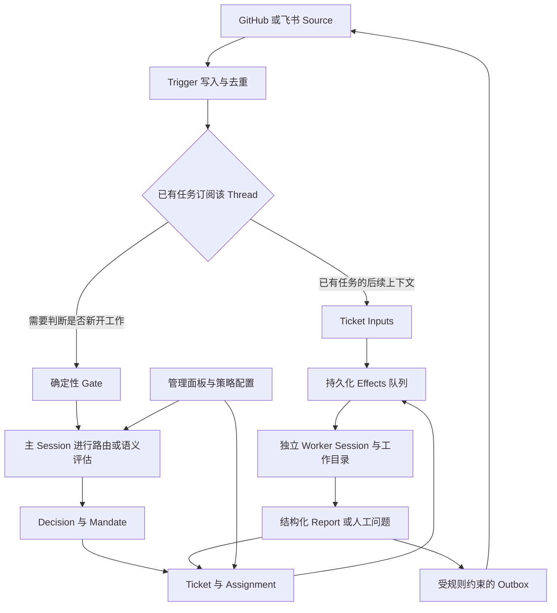
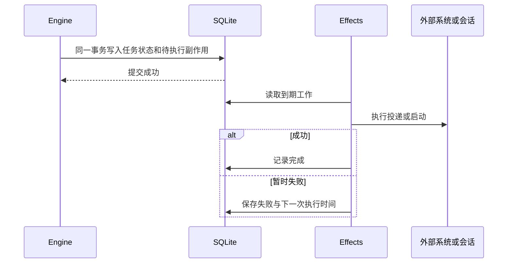

# DeepSeek Super-agent 深度技术研究

从会话助手到事件驱动的持久任务系统

**资料截止：2026 年 11 月 2 日，北京时间。** 研究对象为 DeepSeek 10 月 31 日公开的 Super-agent 设计及 `dsh-superagent-prototype`。源码固定在首发提交 `6337fc823ce20251c8de8085948165c81aaa701e`，包版本 `0.1.0`。本文包含源码分析、官方实验解读、独立运行官方测试的结果与工程建议；不包含真实模型、GitHub、飞书联机部署实测。

## 1. 核心判断

DeepSeek 这次公开的核心，是一套管理持续到来的工作、维护任务授权与状态、协调多个执行会话的系统设计。它值得研究的地方，是把过去由人承担的会话切换、任务认领、反馈转发和故障恢复，变成可以检查、持久化与重试的软件机制。

**最重要的技术变化，是任务成为独立于模型会话的业务对象。** 任务可以等待、恢复、更换一次执行实例，跨飞书话题和 GitHub PR 接收反馈。模型负责有歧义的语义判断和具体工作，确定性程序负责授权准入、状态迁移、订阅、并发配额和副作用投递。由此，系统的可靠性不必全部寄托在模型“记住自己该做什么”上。

本次研究形成五项判断：

1. **可复用价值最高的是任务状态与事件机制。** Router/Worker 的角色分工容易模仿，`Ticket / Mandate / Assignment / Subscription / Effects` 之间的约束才是持续运行的基础。
2. **公开代码已超过概念演示。** 它具备事务、持久队列、消息去重、重启恢复、人工优先唤醒和管理面板。本次在不修改上游代码的情况下，类型检查、59 个测试文件中的 1,197 项测试及构建全部通过。
3. **架构探索与公开原型必须分开。** README 明确将其定位为研究原型，且公开版本与内部实现、设计文章均不完全相同。不能据此宣称完整的云端存算分离、跨设备执行和语义级自愈已经交付。[R1]
4. **官方性能结果支持调度收益，尚不能支持代码质量优势。** 合成实验中的尾部完成时间改善明显，但读取缓存的 token 消耗也增加；其商业价值需要用真实任务质量、人工介入时间和全成本共同衡量。
5. **成熟度的主要缺口在信任边界与长期运行。** 工作目录分离并不等于安全沙箱；授权策略的变化也不等于立即撤销正在运行的工作。这两个细节会直接影响实际部署决策。

## 2. 发布了什么，研究证据有多强

### 2.1 三个容易混淆的层次

| 层次 | 本次可以确认的内容 | 不宜据此推出的结论 |
| --- | --- | --- |
| Super-agent 设计文章 | 提出持续协作的系统架构，并给出初步调度实验 | 所有设计已经产品化；实验已经证明真实编码领先 |
| 公开原型 | 基于 DeepSeek Harness 的 TypeScript bundle，服务一个 GitHub 仓库，可接入飞书 | 已是支持任意企业应用、任意权限域的通用平台 |
| DeepSeek Harness 底座 | 提供会话、工具、模型调用、后台任务等运行能力 | 此次发布了一款新的基础模型，或只能使用 DeepSeek 模型 |

GitHub 元数据显示，仓库创建于 `2026-10-31T09:32:46Z`；所核对提交的时间为 `2026-10-31T12:05:39Z`，对应北京时间 10 月 31 日 20:05:39。仓库采用 MIT 许可证。`package.json` 将 DSH 引擎范围设为 `^0.2.1-alpha.2`；部署文档另给出固定安装版本。前者是兼容性声明，后者是部署指引，不能混为同一个版本字段。[R1][R11]

### 2.2 证据等级

本文将判断分成四类：

- **代码事实**：固定提交下能直接读到的实现、默认配置和测试断言。
- **文档声明**：官方描述的行为或目的；重要部分再与源码核对。
- **作者自报实验**：设计文章中的合成负载结果，不视为独立复现。
- **本文分析与建议**：从实现推导的适用边界，以及尚未实现的改进方案。

官方公众号原文在本次访问时返回环境验证页，知乎原文返回 403。设计文章的实验部分通过明确署名 DeepSeek 产品部的全文转载及其原表核读；这保留了原作者陈述，但没有构成第二个独立实验来源。关键实现结论以官方 GitHub 代码为依据。参考资料末尾分别列出官方入口与实际可读取的转载入口。[R2]

### 2.3 从设计到代码的对应关系

| 设计能力 | 公开原型中可定位的落点 | 实现边界 |
| --- | --- | --- |
| 双层协作 | 主 Session、Worker preset、独立 Ticket 执行 | 主 Session 仍保留一些执行工具 |
| 事件过滤与直通 | Gate、Eval、Thread Subscription、Inputs | 直通有适用条件，主会话仍可能收到通知 |
| 按需组织上下文 | 对象标识、关联读取、摘要与分页 | 不等于已解决跨月记忆与语义更新 |
| 异步工具交互 | 短前台等待、后台 job、事件唤醒 | 工具转后台不等于模型推理可即时抢占 |
| 计算、状态与环境分离 | 领域层和 Executor 接口已有逻辑分工 | 公开部署仍是本地进程、SQLite 和工作目录；未展示完整跨设备服务 |
| 外部监督与恢复 | 状态脚本、另一个 profile 的定时检查指引 | 配置步骤不等于已内置完整的语义进度监督系统 |

此表以代码和部署文档限定能力范围。模块之间可以存在合理接口，并不意味着其分布式部署形态已经完成。[R1][R6][R8][R9][R10][R11]

## 3. 总体架构：模型外面有一个明确的任务系统

下面按公开代码整理执行关系。箭头表示业务流，不代表所有步骤都调用模型。

这一结构可分为四层：

| 层 | 核心职责 | 主要实现 |
| --- | --- | --- |
| 接入层 | 把平台事件翻译成统一对象，维护读取位置与回复地址 | `src/sources/` |
| 领域层 | 授权、任务生命周期、订阅、派工、报告与回复规则 | `src/core/`、`src/policy.ts` |
| 执行与可靠性层 | 会话、工作目录、配额、重试、事务、持久队列 | `src/executor/`、`src/app/store.ts`、`effects.ts` |
| 交互与运维层 | 主会话、面板、提示词版本、状态检查、部署脚本 | `src/app/`、`src/client/`、`scripts/dsh-superagent` |

### 3.1 Router 的重要性在职责收缩

主 Session 需要知道有哪些工作、谁在处理、哪里需要人参与。它不需要持续阅读每个任务的全部代码、测试输出和调试历史。如果调度者也亲自长时间执行任务，新的输入仍会在同一个推理循环前排队，角色名叫 Router 也不会解决阻塞。

公开实现对此采用了组合约束：专用 preset、较小工具集合、路由提示词，以及限制阻塞等待的 `noWait` guard。不过，**主 Session 仍有 Bash、文件读取等工具，“不深入执行”并非完全由工具剥夺保证**。`noWait` 能拒绝一些显式长等待，但不是任意计算的形式化耗时上界。[R9]

这说明应区分两种可靠性：程序可以确保某个工具调用参数不超过阈值，却不能仅靠提示词确保调度模型永远不深入调查。实际监控应包括 Router 每次决策的工具调用量、输出长度与排队时间。

### 3.2 Worker 隔离了上下文，没有隔离全部共享资源

每个 Ticket 对应一个 Worker Session 和工作目录，典型 prepare 命令可建立 Git worktree。这能减少会话污染和直接覆盖工作文件，却不能防止两个任务同时修改共享数据库、占用同一端口、操作同一 PR，或在合并后产生语义冲突。[R8]

因此，并发的前提应是明确任务间的共享资源。目录隔离解决文件工作区问题；分支合并、部署和外部服务操作仍需要独立的协调规则。对高耦合任务，可在进入 Worker 前建立依赖或串行约束，不能仅靠增加 Worker 数量。

## 4. 最关键的抽象：授权、任务、执行与会话分离

### 4.1 为什么需要这些对象

| 对象 | 解决的问题 | 容易误解的地方 |
| --- | --- | --- |
| Trigger | 记录一次不可变的环境事件，提供去重与审计单位 | 相同事件重送不应再生成一份任务 |
| Thread | 把某个话题、Issue 或 PR 的相关事件放在一起 | 一个 Thread 可以有多个 Ticket |
| Eval / Decision | 判断是否开始、停止或忽略工作 | 并非所有后续消息都重新经过模型评估 |
| Mandate | 保存任务为什么被允许，以及允许的范围 | 收到新上下文不意味着取得新权限 |
| Ticket | 保存工作本身的生命周期 | 工作结束不必等于会话销毁 |
| Assignment | 表示这次由哪个 Executor 执行 | 一项工作可以经历多次 Assignment |
| Subscription | 把相关 Thread 的后续事件送到任务 | 关系是多对多，不等于给所有发送者授权 |
| Channel | 表示回复发生在哪里 | 任务输入来源与最终交付位置可以关联多个平台 |

这组划分把“模型暂时停止输出”“等待人工审核”“任务已经完成”“原执行实例中断”分成不同事实。若把它们都压缩为一个 Session 的 `done`，恢复逻辑很容易重做工作，或者误把尚待审核的 PR 当成已交付。[R3][R5]

### 4.2 一项跨平台任务如何运行

设想一名获授权的开发者在飞书要求修复登录故障：

1. Source 记录平台身份、消息和所属话题，生成 Trigger。
2. 准入逻辑与主 Session 判断这是明确请求，创建 Ticket、Mandate 和初始 Assignment。
3. Executor 准备目录，启动 Worker；任务订阅原始话题。
4. Worker 创建 PR，GitHub Source 或报告逻辑把 PR Thread 绑定到 Ticket。
5. PR 评审意见直接进入原任务的 Inputs，Worker 在同一任务上下文内继续修改。
6. 如果评审要求新增一个明显超出原授权的功能，Worker 应交回该消息，由系统重新判断任务归属。
7. PR 的关闭或合并进入任务完成判定；后来的人类跟进在符合恢复条件时可重新打开该工作。

这是依据代码规则构造的说明性例子，不是本次完成的联机演示。它揭示了产品层面的意义：用户可以在业务发生的位置交流，系统负责把消息归到持久的工作对象。

### 4.3 `observe` 不是全部任务的只读模式

主动工作的 accept mode 有三种：`off` 不接受推断型候选；默认 `observe` 记录“本会接受”的判断而不接单；`auto` 才能把满足规则的推断候选转成任务。**明确授权请求在三种模式下都可以执行。** 因此，把 `observe` 理解为整个系统绝不执行任务，会造成错误部署预期。[R4]

### 4.4 策略变更不等于立即停工

Policy 版本变化会使正在进行的旧 Eval 作废并重新排队；对受影响的活跃 Ticket，系统发送策略变化通知，而不会立即撤销全部运行中的 Mandate。已结束任务恢复前，才执行针对授权基础的重新校验。人类明确停止会撤回授权，并阻止旧任务继续接收输入。[R4][R5]

这是连续性与即时撤权之间的取舍。让半完成工作无条件中断可能损害一致性；但企业若要求“移除成员权限后立刻停止相关外部写入”，就需要在工具执行边界增加可撤销的权限检查，不能只等待 Worker 理解一条通知。

同样，面板的暂停处理会停止新评估、派工、输入投递和回复，但不会中断已经运行的 Worker turn。**暂停、停止任务、停止进程、撤销外部凭据，是四个不同的操作。** 运维界面必须让操作者明确知道自己执行的是哪一种。[R8]

## 5. 事件路由：把重复协调变成确定性工作

### 5.1 新工作需要判断，已有工作尽量直达

`Intake.receive` 先检查 Trigger 是否已经存在，再处理订阅关系与输入扇出。任务已经订阅相关 Thread 时，后续上下文可以直接交给它。仍由某个 Ticket 负责的人类跟进不再同时被当作新任务评估，避免同一句话被两个执行链重复认领。超出范围的消息通过 handback 机制归还。[R5]

这里有一个细节：**直通并不意味着 Router 对后续消息完全不可见，也不意味着 Router 成本归零。** 主 Session 仍可能接收 follow-up notice；机器人事件也可能在投递给已有任务之外独立进入 Eval。直通减少的是必须再次依赖模型完成的转发与认领决策。[R5][R9]

### 5.2 多对多订阅有用，也带来放大效应

一个 Ticket 可以关注多个 Thread；一个 Thread 也可以被多个 Ticket 订阅。这样，两个相关任务能看到同一 PR 的变化，却不需要为每对 Worker 建立直接通信渠道。

代价是事件扇出。若同一 Thread 被大量任务订阅，一条高频 CI 消息可能唤醒多个执行者，形成多次模型调用。系统设计应同时观察：接入事件数、过滤后候选数、每条事件的订阅扇出、实际唤醒数。只看 Router 的调用量会漏掉 Worker 侧成本。

### 5.3 批处理需要背压，不能只看平均吞吐

公开实现把编排 pass 串行化，运行中的请求合并为后续 pass，并维护持久队列；这有助于控制同一时刻对状态的修改。主会话的消息注入也利用底座 inbox 组织到达事件。[R6][R9]

从排队论角度，设模型一批可处理 `b` 个候选、耗时 `S(b)`，则该阶段理想吞吐为 `b / S(b)`。只有当 `S(b)` 的增长慢于 `b`，批处理才提高单位时间处理量。这个表达式是分析模型，不是实测拟合。

即使平均吞吐足够，也可能出现长尾：输入突发、模型速率限制、某条有歧义事件消耗大量推理、一个持续失败的有序 relay 阻塞后续消息。生产环境应设置最大积压时长、过载降级与人工接管阈值，不能把“批处理有效”等同于“队列不会失控”。

## 6. 上下文组织：持久信息与当前窗口各司其职

### 6.1 引用图比全量重放更适合持续工作

`orchestrator_read` 的资源包括 Ticket、Thread、Trigger、Assignment、报告、对话记录和原平台记录。返回对象带有关联标识，模型可沿关系继续读取；长文本分页，摘要与读取入口同时保留。[R10]

例如，当前消息指向一个 Thread，Thread 指向 Ticket，Ticket 再指向另一个 PR Thread。模型无需把几个月的记录一次性装入窗口，只需沿这条关系找到相关上下文。这是显式对象检索；不应把它直接称为向量检索系统、知识图谱推理系统或自动学习型长期记忆。

### 6.2 截断策略是接口设计的一部分

公开实现对不同输入设置了不同预算：初始 assignment 文本、后续输入卡片、Worker report、原始记录读取各有长度限制。报告消息内联摘要并给出续读指针，而不是简单把后半段永久丢掉。普通文本页默认 4,000 个 UTF-16 code units，上限 8,000；列表默认 20 项，上限 50 项。[R10]

这些单位不是 token，也不是中文词数。把“4,000 个字符”直接当作“4,000 token”计算 API 成本，会产生系统偏差。

从工程上看，好的截断策略至少要保留三样东西：对象身份、足够判断是否相关的摘要、可恢复原文的入口。若摘要删掉决定性的否定条件，而模型又不知道内容被截断，窗口节省会以错误执行为代价。

### 6.3 持久化不自动产生长期记忆能力

代码有记录、关系与读取接口，但还需要回答：模型能否发现正确入口，旧结论是否过期，矛盾信息如何更新，跨月知识如何压缩，权限收紧后旧内容是否仍可读。

当前文档明确指出多类历史记录尚无删除机制，会持续增长；读取缓存则是内存对象，重启后会消失。这两点并不矛盾：长期业务记录可保留，临时分页缓存仍需重新建立。[R6][R10]

因此，长期部署要设计保留期限、归档、索引维护与访问撤销。没有这些制度，更多历史可能先带来存储负担和信息泄露面，而不是更好的记忆。

## 7. 异步执行与调度：让任务等待不占住人的入口

### 7.1 五秒转后台解决的是工具阻塞

Router 与 Worker 使用专用 preset，前台 shell 命令和 job 等待受到短时间限制，长命令转入后台；结果再以事件方式返回。这让会话有机会在下一推理步处理新输入。[R8][R9]

它不保证任意时刻立即打断模型推理，也不保证端到端响应时间低于五秒。实际响应还包含消息接入、排队、当前推理步、模型服务延迟和下一步执行。报告工具上限时必须与用户可见延迟分开。

此外，Worker 内部的 subagent 使用底座 `standard` preset，其 shell 默认转后台时间不同。不能把主 Worker 的时间限制泛化到每层子任务。[R8][R9]

### 7.2 Worker slot 代表正在占用的执行能力

`WorkerSlots` 在启动或唤醒前同步预留配额，避免两个异步启动同时占到“最后一个空位”。普通任务受 `maxWorkers` 限制；人类跟进或状态请求可以使用一个额外槽位，唤醒优先于新任务启动。[R8]

这个设计值得借鉴：吞吐优化不能让新任务持续挤占人类纠正既有任务的机会。但它不是无限的人类请求优先权——多个同时到来的人类消息仍会竞争有限执行能力。

若 turn 结束时 shell job 或 subagent 仍运行，Ticket 会继续占用 slot。否则，系统会错误地认为 Worker 空闲，释放配额后实际后台并发持续增长。对交付给人审核的运行服务，则有不同的保留规则；后台任务上限也存在明确例外。[R8]

### 7.3 建议按资源而不只按会话限流

一个 Worker 可能只读代码，也可能启动构建、浏览器和多个子任务。相同的 Worker 数并不代表相同的 CPU、内存、模型 token 或外部 API 消耗。

生产化可增加分层配额：全局模型预算、每类任务并发、每仓库写入互斥、每个外部服务速率限制和单任务最大重试成本。对未知价值的主动任务，优先限制可逆探索阶段的预算，再决定是否进入交付阶段。

## 8. 可靠性：事务、队列和恢复比“永远在线”更具体

### 8.1 先提交状态，再执行外部动作

`Engine` 的领域命令是同步的，在事务内修改聚合对象；`Store.atomic` 使用 SQLite savepoint 管理事务，`afterCommit` 处理提交后的内存动作。需要跨崩溃保存的工作写入 `Effects`，提交后再由适配器执行。[R6][R7]

这避免了“系统告诉用户已经接单，但进程崩溃后找不到该任务”的一类不一致。它接近有事务边界的任务流程管理器，并结合 durable queue 与 outbox；由于业务对象本身也被更新保存，不能仅凭它保留 Trigger 就称为纯事件溯源系统。

### 8.2 重试不会天然带来恰好一次执行

`Effects` 按 `kind / key` 去重，同键新 payload 会递增 generation，防止旧执行结束时误删除更新后的工作。`Outbox` 原子地写入消息回执和投递副作用。[R7]

外部写入另有去重：GitHub 评论带稳定 HTML 标记，重试前检查机器人自己的既有评论；飞书回复传递稳定幂等键。它们专门处理“外部已经成功，本地还没来得及确认”的常见失败窗口。[R7]

但这仍不证明任意外部动作恰好执行一次。GitHub 的“读取已有评论，再发送”本身不是与远端共享的原子事务；Worker 通过 shell 发起的其他动作，也不自动受 Outbox 保护。进程恢复后，模型需要检查代码、Git 历史及外部状态再决定是否重做。

对高价值写入，建议把业务幂等键、外部结果查询、提交前校验和人工审批放在专用执行接口中。不要要求模型仅凭自然语言恢复提示承担全部一致性责任。

### 8.3 重启恢复依赖任务和执行实例分离

进程重启时，正在运行的 Assignment 被标记为中断，新 Assignment 带恢复说明重新开始；Worker Session、目录和任务记录可继续利用。等待、审核、阻塞和失败状态按照输入与报告决定是否恢复，并非统一从头执行。[R5][R8]

数据库采用 WAL 与 `synchronous=FULL`，状态目录有进程锁。这些是单机持久性和排他写入措施。公开运行形态仍是一个受锁保护的本地 SQLite 状态目录，不能因此推导出多副本共识、跨机器故障转移或云端弹性调度已经实现。[R6][R12]

### 8.4 Watchdog 的公开交付边界

部署文档要求在另一个 Harness profile 建立每小时检查，依据状态码决定静默、报告配置问题或尝试恢复。脚本还尊重人工停止标记，避免操作者停机后被自动重启。[R11]

这提供了外部检查的实际接法，但与一个持续判断任务是否偏航、并有清晰修复权限的监督系统仍有距离。生产环境应把监控分成进程存活、事件链路健康、任务实质进展三层；“还在产生 token”不能作为任务健康标准。

同机不同 profile 能隔离一部分故障，不能抵御整台机器离线。监督组件也需要预算、审计、修复次数上限和明确的停机优先级，否则会出现恢复循环，甚至不断改写规则来掩盖原故障。

### 8.5 走向跨设备系统还需要补什么

若进一步拆开推进模型循环的计算、持久任务状态和真实执行环境，系统可以在执行设备暂时离线时仍接收消息和保存任务。但“控制面在线”不代表“需要本机环境的工作仍能执行”。后者必须等待设备恢复，或在具备等价环境的其他设备上恢复。这是分布式设计推演，不是当前原型的已交付功能。

沿用公开原型的接口，最少还需要处理以下问题：

| 分布式问题 | 为什么单机机制不够 | 建议补充的机制 |
| --- | --- | --- |
| 多个调度进程认领同一任务 | 本地目录锁不能管理跨机器执行权 | 任务租约与 fencing token，让过期执行者不能继续写入 |
| 设备离线后命令是否实际完成 | 超时只说明没收到确认，不说明远端没执行 | 稳定 operation ID、远端结果账本、重连后查询确认 |
| 恢复时环境已经变化 | 保存会话文本不能保存未提交代码、服务状态或硬件状态 | 记录工作树和环境身份，关键动作前重新校验 |
| 跨信任域调用工具 | 远端 shell 会扩大控制范围 | 每设备与每工具的能力授权、凭据代理、出站限制 |
| 状态与审计分散 | 只能看到一端日志时难以判断重复与遗漏 | 统一关联 ID、可追踪的命令生命周期和审计保留 |

这些机制的作用是让失败可判定、恢复可约束。把 SQLite 换成远程数据库，只完成存储位置的变化；把命令转发到远端，只完成传输位置的变化。两者都没有自动解决执行权、重复副作用和身份边界。

## 9. 安全边界：哪些是硬约束，哪些仍依赖模型

### 9.1 关键约束矩阵

| 问题 | 公开实现中的措施 | 仍需面对的边界 |
| --- | --- | --- |
| 谁能发起新工作 | Source 身份、准入表、白名单、Policy 与 Mandate | 接入身份正确不等于消息正文可信 |
| 后续内容是否改变权限 | 订阅作为上下文；原任务范围继续有效 | 范围是否超出仍需要语义判断，且 Worker 可使用通用 shell |
| Worker 能读哪些业务对象 | 资源接口检查所属 Ticket 与可达对象 | 该接口权限不能阻止完整 OS 权限下的旁路文件读取 |
| 是否隔离本机凭据 | 账号 wrapper 默认选择机器人身份 | wrapper 与工作目录都不是安全沙箱 |
| 自动合并需不需要审批 | Delivery prompt 规定条件 | host 没有专门的合并决策逻辑，应依靠 GitHub 分支保护等外部强制措施 |
| 管理接口能否任意远程访问 | loopback、Host、Origin 与自定义请求头检查 | 本地接口措施不等于企业级多租户身份与权限系统 |

这张表概括的是机制与局限，不是已成功利用的漏洞清单。[R4][R8][R9][R10][R12]

### 9.2 订阅绕过准入，为什么既合理又需要谨慎

已有任务如果每收到一条 CI 或评审意见都重新要求发起权限，协作会非常笨重。因此，订阅消息可以绕过新任务 Gate 作为上下文进入 Worker；已结束但未被人工停止的任务，也可能被相关 Thread 的人类消息唤醒，恢复前检查的是原 Mandate。[R4][R5]

合理的授权语义是：“你仍只被允许完成原工作，但现在有了新证据。”潜在失败是模型把新证据误当成更高权限命令。尤其在外部评论、引用日志、仓库文件中夹杂指令时，业务对象的权限模型并不能单独保证实际工具调用服从授权。

要缩小这一缺口，应把来源身份、正文和引用内容以不同字段保留，并在危险动作处校验结构化权限；跨项目读取、网络出站、部署与合并应使用不同能力。上游已有的授权框架可作为基础，但不能替代操作系统和服务端权限隔离。

### 9.3 默认完整权限决定了部署起点

官方明确说明两种 preset 以操作系统用户身份运行，设置为 `danger-full-access`；源码 `Sessions.ensure` 也直接设置该权限。程序路径 wrapper 不能阻止绝对路径执行。[R9][R11]

所以，最初的适用环境是权限范围清晰、成员可信、外部写入可审查的单仓库团队。更广范围采用前，应使用专属系统账号或受约束的容器环境、最小化凭据、外部写入策略和可撤销权限。容器是否足够，还取决于挂载目录、网络和凭据暴露方式，不能只以“已经容器化”作为结论。

## 10. 官方实验：收益来自哪里，证据还缺什么

### 10.1 原表与口径

作者使用合成群聊和 CI 消息：每次约 300 条，其中约 20 条工作请求；编码由耗时工具替代，每方案运行 5 次。图注明消息间隔和工作时长缩为四分之一，模型调用耗时保留真实值。以下数字为作者自报，非本文复现。[R2]

| 方案 | 完成时间 p50，分钟 | 完成时间 p95，分钟 | 全部 Session 读缓存 token，万 |
| --- | --- | --- | --- |
| Super-agent | 12.4 | 15.7 | 2323 |
| Super-agent 去掉直通 | 12.6 | 15.5 | 3177 |
| 单 Session 加 Subagent，中性提示 | 20.4 | 29.5 | 605 |
| 单 Session 加 Subagent，优先委派提示 | 13.8 | 29.0 | 1082 |

### 10.2 重新计算后的解释

以下算术以原表为输入，用仓库 `financial_rigor.py calc` 计算，并以 Decimal 复核。计算一致不构成独立验证实验真实性。

- 相比中性提示基线，p50 缩短 **39.22%**，p95 缩短 **46.78%**。不能把某一个百分比不加口径地概括为“编码性能提升”。
- 相比优先委派基线，p50 只缩短 **10.14%**，p95 则缩短 **45.86%**。在这组数据里，稳定控制长尾比平均任务加速更值得关注。
- Super-agent 读缓存 token 分别为两种单会话基线的 **3.84 倍**和 **2.15 倍**。这些是读取缓存数量之比，不是总账单之比。
- 相比无直通版本，启用直通节省 **26.88%** 的读缓存 token；反过来说，移除直通增加 **36.76%**。分母不同，不能都写成“节省约 37%”。
- 无直通版本 p95 为 15.5 分钟，完整版为 15.7 分钟；没有方差与置信区间，不能把这个小差异解释为稳定的反向性能优势。

从这些结果能得到的窄结论是：在所用合成负载下，固定分工降低了提示词临场委派的不稳定性，订阅直通节约了协调成本。不能由此推导真实仓库中的缺陷修复成功率、回归率或人工验收负担。

### 10.3 六个实验限制

**第一，执行质量被移出了实验。** 等待工具不会遇到仓库理解、错误实现、测试不足或评审返工。调度再快，也可能只是更快地产生待修正结果。

**第二，时间缩放改变了瓶颈比例。** 当工作耗时和到达间隔缩短、模型耗时不变，协调开销相对于实际工作被放大。这有利于观察调度问题，但外推到长时间构建或复杂编码需谨慎。

**第三，提示词是强干预变量。** 中性和优先委派基线差距本身说明，结果依赖任务描述、工具说明和模型行为。还需对比强制委派、同样直通、相同并发与预算的基线，才能拆开各项贡献。

**第四，五次运行不足以刻画所有尾部行为。** 报告没有据此提供可供本次核查的置信区间；也不能把多次运行内的相关任务当作完全独立样本。

**第五，缓存读取量不是总成本。** 缓存未命中输入、输出、各角色模型、重试、后台工具和人工时间都可能改变结论。

**第六，缺少可直接复跑的完整实验包。** 所核对公开树有大量软件测试，但没有定位到对应四方案实验的完整负载、运行配置、逐次原始结果与统计脚本。这是复现材料缺口，不是说实验一定有误。

### 10.4 下一轮应如何验证

建议把真实任务混入事件流，固定仓库快照和模型版本，对比单会话、强制委派、双层无直通、双层有直通。除完成时间外，至少记录：

| 维度 | 建议指标 | 要回答的问题 |
| --- | --- | --- |
| 质量 | 隐藏测试通过、回归、评审返工、最终合并率 | 更快是否仍然正确 |
| 人工 | 每个验收任务的介入分钟、通知数、重复解释数 | 是否真正释放人的注意力 |
| 成本 | 分模型输入、缓存命中、输出、重试和工具费用 | 多会话的收益是否覆盖成本 |
| 主动性 | 正确触发、误触发、漏触发、无效任务终止率 | 是否在处理值得做的事 |
| 恢复 | 崩溃后重复副作用、输入遗漏、恢复时长 | 状态机制是否覆盖真实故障窗口 |
| 安全 | 未授权外部写入、跨任务越界、撤权后写入 | 授权是否落实到执行端 |

应报告各次运行及置信区间，并把人为终止、失败和超时纳入统计，避免只计算完成任务形成幸存者偏差。

## 11. 成本与技术位置

### 11.1 正确的经济单位是“被验收的工作”

对这一类系统，更有用的指标是：

`单位验收成本 =（模型费用 + 工具与计算费用 + 人工介入费用 + 返工费用）/ 验收通过的任务数`

这是评价框架，不是 DeepSeek 披露的经营数据。原表仅提供部分 token 口径，无法据此估计确定的 API 账单或投资回报。

对主动探索任务，可以先用一个简单决策条件组织实验：`p × V > C + H + R`。其中 `p` 是产出可用结果的概率，`V` 是结果价值，`C` 是计算成本，`H` 是人工注意力成本，`R` 是外部副作用的预期代价。所有参数都需要本团队测量。

这一框架解释了为什么主动探索宜先安排可逆、静默、预算有限的工作。即使没有对外发消息，任务也可能耗费算力或改变工作区；“不打扰”不等于“没有成本”。

### 11.2 它与已有系统思想的关系

| 技术路线 | 主要处理对象 | 对本次研究的启示 |
| --- | --- | --- |
| ReAct | 推理与行动交替的任务过程 | 可继续作为 Worker 内部循环，不直接提供跨任务生命周期治理 |
| LangGraph 持久化 | 线程状态 checkpoint 与跨线程 store | 持久化是可组合能力，仍需应用定义授权、外部副作用和业务完成条件 |
| Anthropic Managed Agents 架构 | 将 harness、session 日志与执行环境解耦 | 云端持续运行和独立替换组件并非 DeepSeek 独有的问题或思路 |
| 公开 Super-agent 原型 | 环境事件、已授权工作与持续跟进 | 优势在把具体团队协作规则落实为可审计的领域对象和执行机制 |

这不是同条件产品跑分。ReAct 论文说明推理与行动的结合；LangGraph 官方文档区分 checkpoint 与长期 store；Anthropic 官方工程文章公开了会话、计算与执行环境分离的设计。[R14][R15][R16]

从本文的系统分析看，Super-agent 的贡献主要在组合与落地：从实际团队的反馈流出发，把事件处理、引用检索、任务恢复、低打扰沟通和授权语义放进一套可运行的工作方式。新颖性不应以“是否第一次出现 Router/Worker”衡量，而应看这些机制组合后能否减少人工协调，同时保持正确性与成本可控。

## 12. 独立验证结果与采用建议

### 12.1 本次完成了什么验证

固定上游提交，在临时目录安装锁文件指定的依赖，未修改上游 tracked 文件；使用 Node.js `24.22.1`、Python `3.12.14`、pnpm `11.25.0`。上游 `packageManager` 声明为 `11.7.0`，本次 pnpm 版本与之不同，锁文件保持不变。[R13]

| 检查 | 结果 | 能证明什么 |
| --- | --- | --- |
| `pnpm typecheck` | 通过 | 在本次依赖和编译环境中类型检查通过 |
| `pnpm test` | 59 个测试文件、1,197 项测试通过 | 官方测试在本机运行通过 |
| `pnpm build` | 通过，保留 CommonJS 格式建议警告 | bundle 可构建；警告不是失败 |
| 关键路径源码核对 | 已完成 | 授权、扇出、事务、队列、工作槽位等有对应实现 |
| 真实平台与模型联机 | 未执行 | 不据此声称实际 PR 质量或线上可用性 |
| 官方四方案性能实验 | 未复现 | 仅核读原表、复算比例并分析方法限制 |

首次测试使用系统旧版 Python，服务脚本因 `shlex.join` 不存在等环境问题出现 10 项失败；切换到满足前置条件的 Python 后，完整检查通过。该问题未通过修改上游源码处理。核验附件保留经过路径脱敏的成功日志、运行步骤、计算结果和逐项证据。[R13]

### 12.2 适合怎样开始

**适合先试的场景**是单仓库、小团队、事件归属清楚、任务可独立验证的工作：问题复现、边界明确的小修复、已有 PR 的评审跟进，以及受规则约束的候选工作观察。

采用过程可分成四步，每一步按可观测结果决定是否继续：

1. **观察事件。** 保持推断任务为 `observe`，检查漏触发、误触发与任务归属；明确请求的执行权限另行管理。
2. **有限执行。** 使用隔离账号和最小凭据，限制仓库、分支和可调用外部服务；人工审核 PR。
3. **验证恢复。** 在测试环境注入进程退出、网络失败、重复事件、发送成功后本地确认失败等情况，检查是否漏消息或重复写入。
4. **扩大任务范围。** 只有真实任务验收质量、人工时间和成本改善成立，才增加主动规则和并发；同时建立存储保留、权限撤销和故障处理机制。

### 12.3 最值得补齐的工程能力

优先补齐的不是更多角色名，而是三个闭环。

**执行权限闭环。** Mandate 应能约束具体工具、数据范围和外部写入，并支持及时撤销；提示词中的审批要求应与平台侧强制规则一致。

**质量和成本闭环。** 将任务产生、验收、返工、花费与人工介入关联到同一个 Ticket，才能判断主动工作是否值得继续。

**长期运维闭环。** 明确数据保留、备份恢复、模型与提示词版本、升级回滚和过载策略。当前原型的单机状态管理是有价值的起点，但距离多租户、高可用服务仍需补充组件与验证。

DeepSeek Super-agent 值得关注的长期方向，是让模型在有明确授权、状态和反馈的系统里持续工作。现有证据已经足以支持深入学习其工程结构、开展受约束的试点；要证明它能稳定替代团队的日常协调负担，下一步需要真实任务上的质量、人工时间、成本和安全数据。

## 参考资料与核验附件

以下代码链接均固定到本次研究提交，避免后续版本改变本文结论。设计文章的转载仅用来读取原作者内容，不作为独立验证来源。

- **[R1] 发布身份与版本。** [官方仓库 README](https://github.com/deepseek-ai/dsh-superagent-prototype/blob/6337fc823ce20251c8de8085948165c81aaa701e/README.md)、[package.json](https://github.com/deepseek-ai/dsh-superagent-prototype/blob/6337fc823ce20251c8de8085948165c81aaa701e/package.json)、[首发提交](https://github.com/deepseek-ai/dsh-superagent-prototype/commit/6337fc823ce20251c8de8085948165c81aaa701e)、[仓库元数据](https://api.github.com/repos/deepseek-ai/dsh-superagent-prototype)。
- **[R2] DeepSeek Harness 团队，Super-agent 设计探索。** [公众号原文入口](https://mp.weixin.qq.com/s/zoS7GlReWPhfCjENGxXCdg)、[知乎原文入口](https://zhuanlan.zhihu.com/p/2099987320443237060)；本次实际读取的[署名全文转载](https://www.chaincatcher.com/article/2300676)，其中第 7 节与[实验原表](https://public.chaincatcher.com/upload/image/20261031/1793458602197-239036.webp)提供性能数据。官方入口访问受限；转载未被当作独立实验。
- **[R3] 领域模型。** [docs/001-domain.md](https://github.com/deepseek-ai/dsh-superagent-prototype/blob/6337fc823ce20251c8de8085948165c81aaa701e/docs/001-domain.md)。
- **[R4] 授权规则与实现。** [docs/002-authorization.md](https://github.com/deepseek-ai/dsh-superagent-prototype/blob/6337fc823ce20251c8de8085948165c81aaa701e/docs/002-authorization.md)、[src/policy.ts](https://github.com/deepseek-ai/dsh-superagent-prototype/blob/6337fc823ce20251c8de8085948165c81aaa701e/src/policy.ts)。
- **[R5] 输入与任务状态。** [src/core/intake.ts](https://github.com/deepseek-ai/dsh-superagent-prototype/blob/6337fc823ce20251c8de8085948165c81aaa701e/src/core/intake.ts)、[src/core/tickets.ts](https://github.com/deepseek-ai/dsh-superagent-prototype/blob/6337fc823ce20251c8de8085948165c81aaa701e/src/core/tickets.ts)、[src/core/evals.ts](https://github.com/deepseek-ai/dsh-superagent-prototype/blob/6337fc823ce20251c8de8085948165c81aaa701e/src/core/evals.ts)。
- **[R6] 事务与持久化。** [src/core/engine.ts](https://github.com/deepseek-ai/dsh-superagent-prototype/blob/6337fc823ce20251c8de8085948165c81aaa701e/src/core/engine.ts)、[src/app/store.ts](https://github.com/deepseek-ai/dsh-superagent-prototype/blob/6337fc823ce20251c8de8085948165c81aaa701e/src/app/store.ts)、[src/app/passes.ts](https://github.com/deepseek-ai/dsh-superagent-prototype/blob/6337fc823ce20251c8de8085948165c81aaa701e/src/app/passes.ts)、[架构文档 Persistence 部分](https://github.com/deepseek-ai/dsh-superagent-prototype/blob/6337fc823ce20251c8de8085948165c81aaa701e/docs/007-architecture.md#persistence)。
- **[R7] 持久副作用与外部去重。** [Effects](https://github.com/deepseek-ai/dsh-superagent-prototype/blob/6337fc823ce20251c8de8085948165c81aaa701e/src/app/effects.ts)、[Outbox](https://github.com/deepseek-ai/dsh-superagent-prototype/blob/6337fc823ce20251c8de8085948165c81aaa701e/src/app/outbox.ts)、[GitHub Channel](https://github.com/deepseek-ai/dsh-superagent-prototype/blob/6337fc823ce20251c8de8085948165c81aaa701e/src/sources/github-channel.ts)、[飞书 Channel](https://github.com/deepseek-ai/dsh-superagent-prototype/blob/6337fc823ce20251c8de8085948165c81aaa701e/src/sources/feishu-channel.ts)。
- **[R8] 执行、配额与恢复。** [docs/003-execution.md](https://github.com/deepseek-ai/dsh-superagent-prototype/blob/6337fc823ce20251c8de8085948165c81aaa701e/docs/003-execution.md)、[DshExecutor 与 WorkerSlots](https://github.com/deepseek-ai/dsh-superagent-prototype/blob/6337fc823ce20251c8de8085948165c81aaa701e/src/executor/dsh.ts)、[background.ts](https://github.com/deepseek-ai/dsh-superagent-prototype/blob/6337fc823ce20251c8de8085948165c81aaa701e/src/executor/background.ts)。
- **[R9] 会话与工具约束。** [sessions.ts](https://github.com/deepseek-ai/dsh-superagent-prototype/blob/6337fc823ce20251c8de8085948165c81aaa701e/src/app/sessions.ts)、[cordis.patch.yml](https://github.com/deepseek-ai/dsh-superagent-prototype/blob/6337fc823ce20251c8de8085948165c81aaa701e/cordis.patch.yml)、[dispatch prompt](https://github.com/deepseek-ai/dsh-superagent-prototype/blob/6337fc823ce20251c8de8085948165c81aaa701e/prompts/dispatch.md)。
- **[R10] 上下文资源与预算。** [resources.ts](https://github.com/deepseek-ai/dsh-superagent-prototype/blob/6337fc823ce20251c8de8085948165c81aaa701e/src/app/resources.ts)、[assessment.ts](https://github.com/deepseek-ai/dsh-superagent-prototype/blob/6337fc823ce20251c8de8085948165c81aaa701e/src/app/assessment.ts)、[cache.ts](https://github.com/deepseek-ai/dsh-superagent-prototype/blob/6337fc823ce20251c8de8085948165c81aaa701e/src/app/cache.ts)、[架构文档的模型接口部分](https://github.com/deepseek-ai/dsh-superagent-prototype/blob/6337fc823ce20251c8de8085948165c81aaa701e/docs/007-architecture.md#model-facing-interfaces)。
- **[R11] 部署与外部检查。** [docs/006-deployment.md](https://github.com/deepseek-ai/dsh-superagent-prototype/blob/6337fc823ce20251c8de8085948165c81aaa701e/docs/006-deployment.md)、[服务脚本](https://github.com/deepseek-ai/dsh-superagent-prototype/blob/6337fc823ce20251c8de8085948165c81aaa701e/scripts/dsh-superagent)。
- **[R12] 运行与管理边界。** [runtime.ts](https://github.com/deepseek-ai/dsh-superagent-prototype/blob/6337fc823ce20251c8de8085948165c81aaa701e/src/app/runtime.ts)、[http.ts](https://github.com/deepseek-ai/dsh-superagent-prototype/blob/6337fc823ce20251c8de8085948165c81aaa701e/src/app/http.ts)、[默认交付提示词](https://github.com/deepseek-ai/dsh-superagent-prototype/blob/6337fc823ce20251c8de8085948165c81aaa701e/prompts/team/delivery.md)。
- **[R13] 本次独立核验。** [核验说明与复跑命令](../../research_notes/deepseek-superagent-20261102/validation.md)、[成功检查日志](../../research_notes/deepseek-superagent-20261102/upstream-check.txt)、[证据索引](../../research_notes/deepseek-superagent-20261102/evidence.json)、[实验数值与复算](../../research_notes/deepseek-superagent-20261102/calculations.json)。
- **[R14] Anthropic，Scaling Managed Agents: Decoupling the brain from the hands，2026-04-08。** [官方工程文章](https://www.anthropic.com/research/managed-agents)。仅用于架构对照，不构成与 Super-agent 的同条件性能比较。
- **[R15] LangChain，LangGraph Persistence。** [官方文档](https://docs.langchain.com/oss/python/langgraph/persistence)。
- **[R16] Yao 等，ReAct: Synergizing Reasoning and Acting in Language Models。** [原始论文](https://arxiv.org/abs/2210.03629)。
