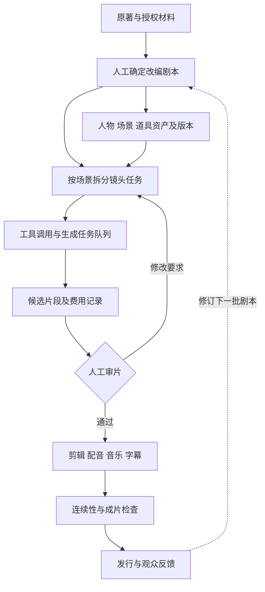

# 《持械入宋》研究报告

> 研究日期与资料截止：2026年11月1日，北京时间。研究对象为老十一剧场／瑾叶剧场出品的 AI 仿真人系列；同名改编、搬运合集与原著数据分别处理。本文属于公开资料调查，没有取得主创后台、合同、模型调用日志或财务账簿，也未完成全剧逐集审看。金额如无特别说明均为人民币。
>
> 核心判断：这是一个值得研究的连续内容生产案例。公开证据已经能解释团队如何组织创作，以及作品如何获得传播；具体模型、软件编排框架和供应商采购份额仍未公开，不能用行业常见配置补齐答案。

## 一、先回答最关心的问题

| 问题 | 本次调查结论 | 证据强度与边界 |
| --- | --- | --- |
| 谁做的？ | 制作团队使用“老十一剧场”和“瑾叶剧场”两个名称；主创身份见下一节 | 具名专访、制作账号及作品索引互相支持；注册公司主体仍未知 |
| 用什么模型？ | 尚不能确认视频、生图、编剧、配音各环节的具体模型及版本 | 没找到本剧工程文件、调用记录或明确的厂商客户案例 |
| 用什么 harness？ | 可以确认有人主导的分工生产流程；不能确认采用哪个软件框架 | OpenClaw、扣子等线索来自相关工作室的其他实验，不能直接归属本剧 |
| 用了哪些公司的服务？ | 原著在番茄小说，剧集在红果，制作账号在抖音；三者均属字节跳动产品体系 | 内容与分发关系成立；不代表制作全程只用字节工具 |
| 数据到底有多大？ | 制作方公开了系列播放突破40亿的喜报；本次直接核对了原帖海报 | 制作方宣称的累计播放，非去重观众数，非平台审计结果 |
| 赚了多少钱？ | 有主创披露的成本、回报量级，见商业分析 | 未知结算期、总成本和收入定义，不能推出净利润率 |
| 能否据此买相关股票？ | 目前只够建立受益环节假设，不能识别哪家模型公司的收入弹性 | 不构成个股估值或买入依据 |

这份报告的证据分为四类：**A 为直接可见的一手页面或主创具名陈述，B 为有来源的媒体报道，C 为第三方索引与聚合数据，D 为本文推演。** A 类也有局限：制作方喜报只能证明其公开宣称了某个数字，不能替代独立流量审计；厂商说明只能证明产品提供某项能力，不能证明本剧购买过它。

## 二、制作商、主创与版权关系

### 能确认的是厂牌，尚未穿透到法人

10月29日刊于澎湃号的具名专访，将张汉生列为总策划、李朝华列为总制片兼总编剧，并确认老十一剧场对应抖音账号、瑾叶剧场对应红果厂牌。团队与雪宝工作室存在师承关系。这里的“澎湃号”是作者／机构发布渠道，不应改写为澎湃记者完成了独立财务调查。〔S01〕

本次直接打开的抖音主页，账号名为“老十一剧场”，抖音号为 `57273298546`。检索时页面显示粉丝44.6万、获赞486.4万；这些属于整个账号，包含其其他作品，不是《持械入宋》的专属指标。〔S02〕

应把产业关系拆成下表，避免把“平台出品”“厂牌名称”“公司股权”混为一谈。

| 层次 | 当前能确认的主体或关系 | 仍需什么证据 |
| --- | --- | --- |
| 原著 | 茶根儿，同名小说在番茄连载；官方书页说明已改编并在红果上线 | 小说及各类改编权的具体授权合同 |
| 制作／运营厂牌 | 老十一剧场、瑾叶剧场 | 对外签约公司全称、统一社会信用代码、片尾署名 |
| 师承 | 主创专访披露与雪宝工作室的学习关系 | 不能据此推定股权、雇佣、联合出品或分账关系 |
| 正片平台 | 红果 | 本剧保底、分账、独家期限、续季授权条款 |
| 宣传与内容账号 | 抖音老十一剧场 | 账号收益与剧集平台收益的拆分 |
| 模型／云服务采购 | 未能确认具体供应商清单 | 发票、采购合同、调用日志或可对应镜头的制作工程 |

原著官网截至本次检索显示约170.3万字、仍在连载，最近更新时间为11月1日17:03。这说明故事供给还在延伸，但小说长度不能直接换算为短剧剩余季数。〔S03〕

本次没有找到足以唯一对应制作厂牌的工商主体。因此，不把名字相近的“瑾叶文化”“影视传媒”公司接到这条链上，也不采纳缺少主创或工商证据的创始人传闻。若要进行商业合作，**先核实收款及授权主体，再讨论技术能力**，否则可能连合同应该与谁签都不清楚。

### 字节生态关系可以确认，版权所有权不能跳步推定

字节跳动官网将 Douyin、Fanqie Novel、Hongguo 列为旗下产品。因此，本剧确实处在同一集团覆盖原著、短剧观看和短视频传播的环境中。〔S04〕

但番茄连载不等于字节拥有作品的一切权利，红果播放不等于平台全额出资。番茄官方对作者收益的说明，明确区分渠道收益和改编版权收益，并按合同结算。这是理解一般商业关系的依据，不是本剧合同的替代品。〔S05〕

## 三、模型与服务商：可追查的线索有哪些

### 为什么不能直接给出“Seedance做的”

首先要分清四个不同对象：**模型**负责生成；**产品**提供操作界面；**harness**负责把任务、工具、素材和结果组织起来；**制作团队**决定哪些结果可以进入正片。同一个产品可以接入多个模型，同一部剧也可能跨季换模型、按镜头混用模型。

主创专访中的Seedance 2.0出现在行业成本变化的叙述中，没有明确说它用于本剧。关键词同处一篇文章，不能作为采用证据。〔S01〕

字节官方确认 Seedance 2.0 支持文本、图片、音频、视频输入，并可经即梦、豆包、火山方舟使用。这只能证明存在这些技术路径。〔S06〕

甚至“上映时间接近某模型发布”也不足以辨认版本：官方资料显示 Seedance 2.5 于7月31日发布，早于媒体报道的本剧首季上线日期。仅凭时间窗，无法在不同版本之间作出归因。〔S07〕

### 服务商与工具证据表

| 公司／项目 | 产品或服务 | 查到的直接证据 | 对《持械入宋》的判断 |
| --- | --- | --- | --- |
| 字节跳动 | 番茄小说、红果、抖音 | 原著书页、制作方原帖、主创专访 | 内容与分发链条已确认 |
| 字节跳动 | Seedance、即梦、火山方舟 | 官方产品能力；相关工作室曾用即梦制作其他作品 | 本剧模型、版本、调用入口均未确认 |
| 快手 | 可灵 | 雪宝在其他作品制作中的使用陈述；快手官方产品资料 | 有相关团队工具经验线索，未确认本剧使用 |
| 商汤 | Seko | 官方报道雪宝工作室参与其产业生态；Seko有跨集资产与画布能力 | 不能推出本剧使用Seko，也不能推出商汤承包全部算力 |
| OpenClaw开源项目 | Agent运行与工具调用系统 | 雪宝接受新榜采访时谈及使用实验 | 相关工作室试用过；本剧是否采用、如何部署未知 |
| 扣子（Coze） | 智能体工作流 | 同一采访提到雪宝此前做过智能体工作流 | 不能当成本剧的编排框架 |
| Google相关产品线索 | Nano Banana | 同一采访提到雪宝尝试让Agent调用它画图 | 只是一条实验线索；版本、实际服务入口及本剧采购均未知 |
| 尚未核实归属 | AI拍 | 雪宝另一部作品的工具名单中出现该名称 | 产品名称不能直接映射为本剧供应商或某家上市公司 |
| 其他常见工具 | ComfyUI、Dify、LangGraph、n8n等 | 本次未查到项目级使用证据 | 不列为已采用框架 |
| 配音、音乐、后期、存储 | 独立语音模型、音画联合生成、剪辑软件、云盘等 | 本剧具体品牌未披露 | 不能凭声线、字幕错误或成片风格辨认供应商 |

表中关联线索的出处需要逐条保留：2月的雪宝专访谈的是《长恨》使用可灵、即梦、AI拍，**不是《持械入宋》**；3月的新榜采访涉及 OpenClaw、扣子和 Nano Banana 实验；5月商汤官方报道的是生态活动与工作室经验分享。〔S08〕、〔S09〕、〔S10〕

这条证据链的正确读法是：相关创作者具备多工具经验，存在沿学习关系传播方法的可能。它的错误读法是：老师用过某工具，所以徒弟的每一部作品都使用它。前者可用于下一轮访谈定位，后者不能进入事实清单。

Nano Banana的Google归属可以由厂商资料确认；采访中的俗称仍不足以辨认具体版本或第三方调用入口。〔S23〕

### 还不能回答的关键技术问题

比“模型名称”更有生产价值的，是下面这些未披露信息：人物资产是参考图还是训练过的专用权重；长镜头是否拆成多个短片段；音画是否同次生成；不同季是否升级底模；使用网页订阅、API还是第三方聚合服务；付费额度是否包含赠送或补贴；失败任务是否收费。

这些问题会直接改变供应商归因和成本解释。例如，即使确认使用某款视频模型，付款对象仍可能是聚合平台；即使画面人物稳定，也不能推定训练了 LoRA。**成片展示的是结果，不会自动暴露实现路径。**

## 四、harness：能确认的生产方式与不能确认的软件

### 公开的生产信息

主创披露：全团队30余人，本剧核心10人，包括5名编导、2名剪辑、1名总导演及两位主创；筹备约半月，先理解原著、改剧本、定人物和样片，随后分工生成、集中剪辑。人物有专属资产；普通镜头平均约3次生成，复杂战争镜头需10次以上，有时超过20次；更新目标约每周一季、每季100集。〔S01〕

这里真正能确认的是：它至少有人的内容把关、资产约束、分工和剪辑交接。专访没有提供编排代码，也没有说明每个步骤由Agent自动执行。将其称为“有人主导的生产流水线”有依据；宣称“某个多Agent框架全自动完成”则越过了证据。

作为概念参照，ComfyUI官方将自己描述为可连接模型与操作的节点式生成系统；Seko官方介绍了由剧本形成画布、关联角色场景及跨集调度资产的能力。这说明同一类生产需求可以有不同实现，**不能反过来用需求相似性识别本剧用了哪个产品**。〔S11〕、〔S12〕

### 把“harness”拆成可检查的功能

以下是本文提出的分析框架，不是对本剧内部系统的披露。对长篇AI剧，harness至少应回答六个问题：

| 功能 | 具体要保存或控制什么 | 为什么影响成片 |
| --- | --- | --- |
| 剧情状态 | 人物已经知道什么、拥有何物、处于何地 | 防止跨集关系和事件顺序冲突 |
| 资产身份 | 角色脸、服装版本、场景、道具的唯一编号 | 防止多个编导使用不同版本的人物 |
| 镜头任务 | 台词、角色、景别、时长、参考素材、负责人 | 让并行生产具备共同标准 |
| 生成执行 | 模型版本、参数、失败状态、重试上限、费用 | 防止无法复现与无限消耗额度 |
| 质量门槛 | 面容、动作因果、口型、语音、字幕及叙事检查 | 把“生成成功”与“可以播出”分开 |
| 剪辑交付 | 选中的候选、音轨、时间线、修订记录 | 确保返工找得到源头，换模型不破坏已完成资产 |

一个用于理解上述功能的参考结构如下，**整张图是本文建议架构，不代表剧组实际部署**。

在这个结构中，Agent可以辅助拆分任务、整理表格、检查素材缺失和调度工具；人仍然要确定剧情取舍与表演是否成立。OpenClaw属于可组织工具与模型的运行系统，但“采用Agent”本身不等于拥有完整的影视制作管线。〔S13〕

### 为什么组织能力可能比框架名字更重要

以下属于D类判断。多人生产时，最容易损失效率的环节未必是单次生成速度，而是信息交接：同一角色的外貌改动没有同步、某件武器在上下镜头突然变形、剪辑需要补镜头却无法找回提示词。没有可追溯的资产和任务记录，更快的生成只会制造更多难以筛选的候选。

反过来，工具可以相对简单，只要参考资产统一、导演决定稳定、返工能回到责任人，就可能形成可靠交付。因此，对本剧技术护城河的合理假设，是“内容判断与生产协作积累”；是否还拥有独占软件或专有模型，则没有证据。

## 五、短剧数据：把播放、收藏、热度放回各自口径

### 可以核对的主要时间点

| 事件／统计日期 | 数据或事件 | 来源性质 | 应如何使用 |
| --- | --- | --- | --- |
| 2026-08-22 | 媒体报道AI仿真人第一季上线 | B，新播场9月报道 | 首季日期有报道支持，未取得平台首发后台 |
| 2026-09-10至09-11 | 第四季上线，报道次日AI新剧榜第一、热度超过5000万 | B，同一报道 | 特定时间与榜单，不能写成长期总榜第一 |
| 2026-10-08 | 制作方海报：系列播放突破40亿，系列累计收藏620万，第一季收藏突破200万 | A，已直接看原帖画面 | 三个指标分别记录，收藏不是去重用户 |
| 2026-10-18 | 制作方发帖庆祝第九季热度突破8200万 | A，已直接核对标题及发布时间 | 热度值，不能写成该季播放量 |
| 2026-10-28 | 新榜报道已更新至10季、红果收藏1098万 | B，媒体观察及引用制作账号 | 不能和播放量相加；没有独立用户明细 |
| 2026-11-01检索 | 制作账号粉丝44.6万、获赞486.4万 | A，主页显示 | 账号级累计指标，涵盖其他作品 |

对应来源编号：S14、S15、S16、S17、S02。

其中40亿的证据链已经回到制作方原帖：海报写的是系列播放，新榜将其描述为全网累计播放。本文没有拿到逐平台拆分，无法判断是否包含分集播放、重复观看、不同发布账号及二创流量；因此也不能计算真实触达人数、完播观众数或每人观看时长。

收藏更接近用户继续观看的意向信号，但同一个人可能收藏多个季。缺少去重方法时，把跨季收藏相加后称为“千万粉丝”是不成立的。

### 第十季：同时观察高点和回落

下表来自“短剧工程”的公开聚合页面，属于C类辅助数据。该站正文交替使用“抖音日榜”和“红果短剧日榜”，虽声称采集公开榜单，却未在页面提供可直接复核的官方原始记录。这里保留其表内数字，**不将其包装为本次亲自查到的红果官方后台数据**。

| 日期 | 该站记录的名次 | 热播指数，单位：万 |
| --- | --- | --- |
| 2026-10-24 | 1 | 7921 |
| 2026-10-25 | 2 | 7557 |
| 2026-10-26 | 2 | 7103 |
| 2026-10-27 | 4 | 6806 |
| 2026-10-28 | 4 | 6566 |
| 2026-10-29 | 5 | 6385 |
| 2026-10-30 | 4 | 6247 |
| 2026-10-31 | 10 | 5874 |
| 2026-11-01 | 28 | 5610 |

在该表自身口径下，末日指数较首日下降29.18%。它提示上线初期集中释放、随后回落的走势，但不能证明观众流失比例，更不能由此认定收入同步下跌。累计播放与滚动热度完全可以一个上升、一个下降。〔S18〕

### 季数、集数和评分的陷阱

本次可靠报道能够确认至少已有十季。关于第十一季，搜索结果中有预告、延期和剧情介绍等互相冲突的说法；没有取得稳定的一手上架确认，因此不把它写成已经播出，也不引用未经核实的预约数。

“每季约100集”只能作为生产体量的粗略描述。短剧百科第十季页面列99集、约2小时41分钟；这种索引差异可能来自拆集、版本或采集方式，不能用季数机械乘出精确总集数。该页还把“995播放”与千万级热度并列，但没有给出播放统计范围，本文不采用这个数字衡量全网影响力。〔S19〕

同样，不将站点显示的9.0分写成豆瓣评分，不将搜索摘要缓存的旧热度标为11月1日实时值，也不把未经核验的合集总时长当作官方交付时长。

## 六、为什么它能吸引持续观看

这部分是基于官方原著简介、媒体描述和观众反馈的内容机制分析，不是完整观影后的审美评分。

原著设定的核心是五个现代人的分工：统筹、狙击、军械、通信、医疗。新榜对剧集的描述，也把这套分工与北宋末年的生产、组织和政治问题相联系。〔S03〕、〔S17〕

由此可以提出三种可检验的解释。

第一，**增长来自问题逐层扩大**。小队先要生存，再解决地方秩序和生产能力，随后进入更大的军事与政治结构。只要上一轮解决方案会带来下一轮约束，就有持续追更的动力。验证这种解释，需要观察同一批观众能否跨季留存，而非只看首集曝光。

第二，**群像分工能让信息密度转化为故事进展**。通信、医疗和军械等知识不只是台词装饰，而可以分别承担冲突解决功能。若人物只剩专业名词、关键问题总由某个主角突然解决，这个优势就会消失。

第三，**生成式视频改变了某些题材的可呈现范围**。对小团队而言，战争、古代城市和多人场面的实现方式变了；但画面规模扩大，不等于叙事自动变好。观众仍须理解战场方位、行动后果和人物代价。因而“有大场面”与“观众关心谁活下来”是两种能力。

也不能只看赞誉。番茄原著评论中能看到对感情线和人物行为的质疑；这是书友／观众混合的自选择反馈，不能外推成全体剧迷满意度，却提醒我们：组织建设题材吸引来的观众，未必接受后续情感支线的处理。〔S20〕

由此得到的竞争判断是：人物、世界和持续冲突一旦形成，续作可能享有理解成本较低的优势；同时，长线制作也更容易累积设定矛盾、画风变化和更新压力。是否成为稳定IP，要靠后续留存与收益证明，不能只靠一次峰值。

## 七、成本与商业回报：哪些账可以算，哪些不可以

### 主创披露不是完整利润表

李朝华在上述专访中称，整个系列累计算力投入超过100万元，商业回报约千万元。本文保留这两个量级及其归因，不将“商业回报”改写为审计收入或净利润。〔S01〕

至少存在四个缺口：回报对应的结算期间是否与算力投入一致；回报是到账、应收、平台估算还是多类收益合计；算力数字是否含补贴及第三方服务；剧本授权、人员报酬、后期、管理与推广费用各有多少。

因此，不能用两个量级相除后宣布投资回报率，也不能只减去算力便宣布净赚多少。媒体转载同一主创陈述，并不能形成第二个独立财务来源。本项目财务数据应维持“主创自述、未审计”的等级。

更合理的项目账应该写成：

> 项目贡献 = 实际确认收入 − IP及剧本成本 − 人员成本 − 生成及后期工具成本 − 推广成本 − 其他直接费用。
>
> 可分配现金还需考虑应收未到账、税费、团队分成，以及已经投入但尚未上线的续季。

### 真正应该测量的是“可交付一分钟”的成本

以下是D类教学情景，**全部金额和比例均为假设，不是本剧账单，也不是任何厂商现价**。设最终每个镜头采用5秒、每次生成收费2元，且生成时长与采用时长相同，不计其他费用，则：

`每分钟生成成本 = 60 ÷ 采用秒数 × 每次费用 × 平均尝试次数`

| 假设情景 | 镜头组合与尝试次数 | 平均尝试次数 | 每分钟生成成本，元 |
| --- | --- | --- | --- |
| A | 全部镜头各尝试3次 | 3.0 | 72.00 |
| B | 80%的镜头尝试3次，20%尝试10次 | 4.4 | 105.60 |
| C | 60%的镜头尝试3次，40%尝试20次 | 9.8 | 235.20 |

这张表的意义是：即使模型单次报价不变，镜头难度组合也能显著改变实际成本；如果最终仅采用生成片段的一部分，单位成片成本还会提高。平均尝试次数也不能简单理解成模型独立成功概率，因为创作者往往会修改提示词、参考图和镜头设计。

从经营角度看，好的系统至少要记录三类损耗：失败生成，技术上可用却不符合导演意图的片段，以及进入剪辑后又因上下文不连贯而淘汰的片段。仅统计“生成成功率”，会低估后二者。

### 系列化可能改善经济性，也可能延迟暴露问题

人物和场景资产复用、观众认知积累、稳定的内容组织方式，都可能摊薄后续制作成本。这是合理机制，尚不是本剧已量化的成本曲线。

相反，续季增加并不保证边际利润提升：更复杂的战争戏可能提高返工，更新压力可能扩大团队，前几季观众也可能对重复桥段失去兴趣。缺少逐季收入、成本和留存表时，不能把“季数越多”直接解释为“商业护城河越深”。

## 八、哪些公司可能捕获价值

本节是产业机制推演，不是本剧供应商营收确认，更不构成投资建议。

| 环节 | 收入或价值如何形成 | 本案例能支持什么 | 尚缺的关键证据 |
| --- | --- | --- | --- |
| 原著与版权 | 阅读消费、改编授权、衍生开发 | 已有同名小说与短剧之间的改编关系 | 授权费、权利范围、作者分成 |
| 内容制作厂牌 | 承制报酬、平台合作收益、可延续的作品品牌 | 可辨认的团队与系列化产品 | 逐季现金回款、非爆款项目损失、利润分配 |
| 分发平台 | 聚合观看需求，销售广告或其他商业服务 | 字节产品覆盖多个内容触点 | 本剧为平台带来的增量时长及商业价值 |
| 生成模型公司 | 按调用、订阅或企业合作获得收入 | 说明存在生成需求，不足以确认哪家拿到多少 | 调用账单、实际折扣、赠送额度、供应商占比 |
| 编排与资产工具 | 降低返工和协作成本，收取软件服务费 | 生产问题客观存在 | 本剧具体工具、团队是否愿意长期付费 |
| 云与算力基础设施 | 承载模型训练、推理或素材处理 | 位于模型与平台服务的更下游 | 采购链条、芯片与云的实际归属 |

字节在这个案例中最确定的联系，是原著和分发触点。快手可灵具备面向Agent的MCP、CLI能力，商汤Seko提供面向连续创作的资产工作流，二者都说明厂商在向制作流程延伸；但这种产品方向不等于已经获得《持械入宋》的订单。〔S04〕、〔S21〕、〔S12〕

对模型公司的收入弹性，还要同时考虑两种相反力量：创作者做更多作品会增加调用；模型更准、返工更少又可能减少每分钟成片所需调用。行业内容产量增长，并不自动等于任一模型厂商收入同比例增长。

对创作工具而言，真正有价值的位置可能是保存长期资产和协作记录。如果模型接口可以替换，持续积累的人物版本、镜头设计和质量标准可能比单次生成按钮更难迁移。这是可跟踪的商业假设，尚需客户留存与付费数据验证。

## 九、容易被写错的结论，以及下一步应取得的证据

| 常见说法 | 本次处理 |
| --- | --- |
| “红果上的爆款当然用Seedance做” | 分发平台不能证明生成模型 |
| “师承雪宝，所以用了OpenClaw／Seko／可灵” | 学习关系不能替代项目级证据 |
| “人物稳定，说明训练了专属大模型” | 参考素材、人工筛选等不同机制也可能实现类似结果 |
| “40亿播放等于几十亿人看过” | 累计播放未去重，包含哪些平台与账号也未披露 |
| “热度8200万就是播放8200万” | 热度和播放属于不同指标 |
| “商业回报减算力就是净利润” | 缺总成本、期间与收入确认口径 |
| “一周一季意味着从零到交付只需一周” | 发行节奏不等于全部生产周期，可能存在前置筹备与库存 |
| “用户称建模好，因此用了3D建模软件” | 日常观感用语不能当作技术架构说明 |
| “某篇文章列出四家上市公司，就是本剧供应商” | 需要采购、合作或主创证据，不能把行业举例写成供应链 |

检索中还出现一篇将本剧与多家上市公司并列、描述所谓幕后细节的文章，但页面末尾自标为虚构演绎。它不进入技术或财务证据链。这类材料最容易被二次转述成“揭秘”。〔S22〕

若能接触主创，最有价值的补充材料按优先级排列如下；本次没有代用户联系或发送访谈请求。

1. **分季、分环节工具表**：模型全名、版本、采购入口、实际使用期间，最好能对应一段成片及其原始生成任务。
2. **一个脱敏镜头的完整工程**：剧本、参考图、所有候选、最终选择、重试次数、剪辑时间线；它能检验宣传口径与真实交付之间的距离。
3. **harness的实际形态**：人工表格、商业软件、节点工作流还是自研代码；哪些步骤自动执行、哪些步骤必须由人决定。
4. **注册与授权主体**：制作公司全称、原著授权链、数字人物资产和配音素材的权利归属。
5. **分季收益与成本**：实际到账、应收、平台奖励、版权、人力、工具与推广开支，使用相同结算期间。
6. **平台分析导出**：去重观看人数、有效观看时长、完播率、跨季回访、自然与付费流量拆分；附指标定义及统计时间。

只有这些材料到位，才可能把本报告升级成供应商份额研究、可复制生产方案或项目回报评估。目前最坚实的认识是：作品的连续生产需要内容判断、资产管理、生成筛选和发行配合；任何单一模型或框架的功劳，都还没有被公开证据单独识别出来。

## 十、来源与审计说明

所有来源均在2026年11月1日检索。正文的S编号对应文末参考资料；[证据登记表](./sources.md)记录来源类型、用途和限制，[指标记录](./evidence.json)保留本次观察值及推演参数。

核验遵循三条原则：同稿转载不计独立来源；主创自述与后台审计分开；未找到证据不等于证明没有使用。模型选择、法人主体、供应商份额和财务利润仍属于明确未解决项。

计算通过仓库的 `financial_rigor.py` 复核，并用Decimal再次校验。报告使用 `report_audit.py` 提取数字，结合人工检查区分真实观察值、第三方记录、教学假设和不适用项；工具本身不能联网确认技术栈，也不能证明制作方宣称真实。完整范围与结果见[审计说明](./audit/README.md)。

本报告适合用作公开资料研究和后续尽调提纲，不应当作已取得内部制作资料的“全流程揭秘”。

### 参考资料

- S01：[一个“草根”团队的两年——对话头部IP《持械入宋》团队](https://www.thepaper.cn/newsDetail_forward_34352445)
- S02：[老十一剧场抖音主页](https://www.douyin.com/user/MS4wLjABAAAAKUlKQSSrVSJ4yonh423oZKP2aSb7_lreNFrB9DWJP8E)
- S03：[番茄小说《持械入宋》书页](https://fanqienovel.com/page/7616151491132279832)
- S04：[ByteDance Products & Services](https://www.bytedance.com/products-services)
- S05：[平台稿费&福利内容大揭秘](https://fanqienovel.com/writer/zone/article/7632280421778079806)
- S06：[Seedance 2.0正式发布](https://seed.bytedance.com/zh/blog/official-launch-of-seedance-2-0)
- S07：[Introducing Seedance 2.5](https://seed.bytedance.com/en/blog/one-take-creation-flexible-referencing-introducing-seedance-2-5)
- S08：[专访雪宝工作室](https://m.thepaper.cn/newsDetail_forward_32566941)
- S09：[用“龙虾”做AI短剧效率翻10倍？理想很美好，现实很骨感](https://cp.newrank.cn/article/detail/34131)
- S10：[商汤Seko产业基地在沪启动](https://legacy.sensetime.com/cn/news-detail/51170691?categoryId=72)
- S11：[ComfyUI官方仓库](https://github.com/Comfy-Org/ComfyUI)
- S12：[商汤Seko上线“无限画布”](https://www.sensetime.com/cn/news/51170693)
- S13：[OpenClaw文档](https://docs.openclaw.ai/)
- S14：[今年还没过完，但年度最佳AI短剧已经有了？](https://finance.sina.cn/cj/2026-09-11/detail-inirnaiy8941365.d.html)
- S15：[持械入宋喜报](https://www.douyin.com/video/7694063424465383498)
- S16：[祝贺持械入宋第九季热度突破8200万](https://www.douyin.com/video/7697835268295925834)
- S17：[被骂“降智”的AI短剧，靠40亿播放的《持械入宋》扳回一局](https://newrank.cn/article/detail/34814)
- S18：[第十季榜单趋势](https://www.duanjugongcheng.com/cn/bangdan/ju/chi-xie-ru-song-di-shi-ji)
- S19：[持械入宋：第十季](https://duanjubaike.org/zh-Hans/drama/73184)
- S20：[番茄读者评论](https://fanqienovel.com/comment/7616151491132279832-7670614769153639192)
- S21：[快手2026年第二季度及中期业绩](https://ir.kuaishou.com/zh-hans/news-releases/news-release-details/kuaishoukejifabu2026niandierjidujizhongqiweijingshenhecaiwuyeji)
- S22：[AI漫剧杀疯了！《持械入宋》爆火……](https://app.myzaker.com/news/article.php?pk=6acb6da48e9f0956ec44a4ce)
- S23：[Image editing in Gemini just got a major upgrade](https://blog.google/products-and-platforms/products/gemini/updated-image-editing-model/)
