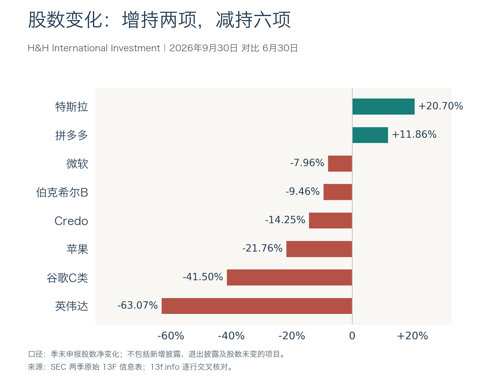
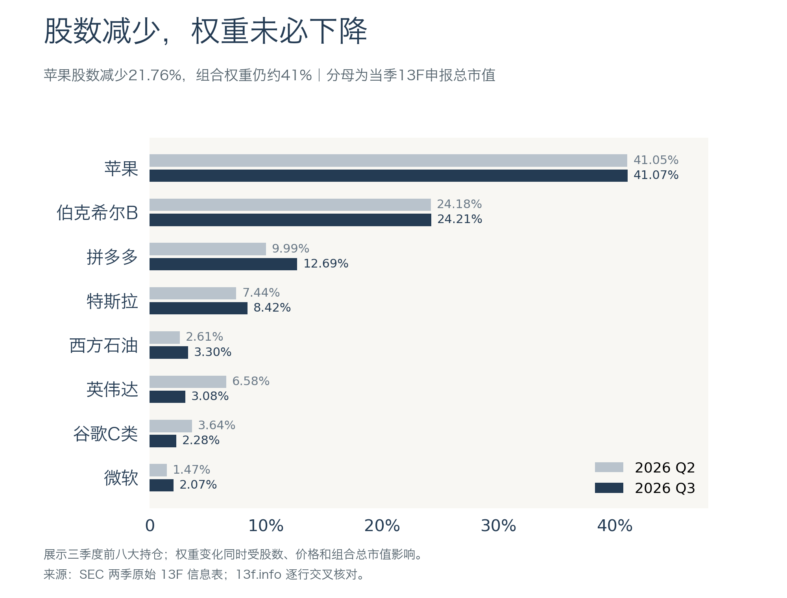

# 段永平三季度持仓：减苹果、英伟达，加拼多多、特斯拉

> 数据截止：2026 年 11 月 17 日。比较 H&H International Investment, LLC 截至 2026 年 9 月 30 日与 6 月 30 日的 13F；三季度文件于美国当地 11 月 16 日提交。增减持指两次季末申报股数的净变化。

段永平控制的 H&H 三季度持仓，最主要的变化是：**增持拼多多、特斯拉，减少苹果、英伟达等持股。苹果与伯克希尔合计仍占 65.28%，集中格局延续。**[1][2][5]

## 一、两项增加、六项减少，完整变化在这里

三季度申报市值为 171.91 亿美元，上季度为 191.01 亿美元，减少约 10.00%；申报条目由 18 项降至 16 项。

这个降幅不是季度收益率：市值同时受股价、持股数量和资金进出影响，缺少完整现金流，不能据此判断盈亏或现金余额。

原有持仓中，2 项股数增加、6 项减少、7 项相同；另有 1 项新出现、3 项未再披露。发生增减的八项如下，拼多多按美国存托股（ADS）单位比较。

| 标的 | 二季度末股数 | 三季度末股数 | 幅度 |
|---|---:|---:|---:|
| 拼多多 | 25,022,094 | 27,990,859 | +11.86% |
| 特斯拉 | 3,380,400 | 4,080,000 | +20.70% |
| 苹果 | 27,098,707 | 21,202,403 | -21.76% |
| 伯克希尔B | 9,229,696 | 8,356,796 | -9.46% |
| 英伟达 | 6,280,675 | 2,319,475 | -63.07% |
| 谷歌C类 | 1,968,600 | 1,151,700 | -41.50% |
| 微软 | 754,100 | 694,100 | -7.96% |
| Credo | 701,200 | 601,300 | -14.25% |

*图：以二季度末股数为基数，不代表成交金额。精确差额见[两季对照附件](../../research_notes/段永平13F-2026Q3-20261117/comparison-table.md)。*

## 二、苹果少了两成，为什么权重仍是41%？

苹果股数减少 21.76%，权重却从 41.05% 微升至 41.07%。原因有两个：申报市值折算的期末每股价格，从 289.36 美元升至 333.02 美元，抵消了部分股数减少带来的市值下降；同时，申报组合的总市值也缩小了。

所以，苹果持仓市值由 78.41 亿美元降至 70.61 亿美元，占组合的比例却基本不变。**权重稳定，不代表没有减持；股数下降，也没有改变苹果的第一大持仓地位。**

伯克希尔B股数减少 9.46%，权重仍约 24%。两者合计占比由 65.23% 变为 65.28%，组合的两大核心没有换位。

*图：权重以各季度 13F 总市值为分母，受股数与期末价格共同影响。*

## 三、拼多多与特斯拉增加，英伟达降至第六

拼多多增加 296.88 万份 ADS，增幅 11.86%；权重由 9.99% 升至 12.69%，仍排第三。它是本季结构变化中最清楚的方向之一：持有数量更多，在组合中的分量也更重。

特斯拉股数增加 20.70%，权重由 7.44% 升至 8.42%，仍排第四。它的持仓市值仅由 14.22 亿美元增至 14.48 亿美元，因为两期申报折算的每股价格从 420.60 美元降至 354.81 美元，抵消了大部分增持带来的市值增加。

英伟达则减少 63.07%，从 628.07 万股降至 231.95 万股；权重由 6.58% 降至 3.08%，排名从第五退到第六。谷歌C类减少 41.50%，权重降至 2.28%。

西方石油因此也值得留意：它升至第五，但两季末都是 10,261,500 股，排名上升并不等于增持。

这些数据能说明公司之间的配置变化，不能证明具体交易动机，也不能直接给出今天的合理买入价。

## 四、SpaceX新出现，三项未再披露

SpaceX 是本次两季对照中的新增条目：199,900 股，市值约 3,016 万美元，占组合 0.18%，排第十二。这是一个小比例持仓，不能解读成组合重心转向。

阿里巴巴、Circle、Innodata 上季在表内，本季未再披露。两季末股数相同的七项是西方石油、迪士尼、联合健康、Palantir、Snowflake、新思科技和 Tempus AI；这也不代表季度中间从未交易。

## 五、16项持仓，前五大占近九成

下表按三季度末市值排列，金额四舍五入。

| 标的 | 市值（亿美元） | 组合权重 |
|---|---:|---:|
| 苹果 | 70.608 | 41.07% |
| 伯克希尔B | 41.613 | 24.21% |
| 拼多多 | 21.816 | 12.69% |
| 特斯拉 | 14.476 | 8.42% |
| 西方石油 | 5.677 | 3.30% |
| 英伟达 | 5.297 | 3.08% |
| 谷歌C类 | 3.924 | 2.28% |
| 微软 | 3.560 | 2.07% |
| 迪士尼 | 1.790 | 1.04% |
| 联合健康 | 1.467 | 0.85% |
| Credo | 1.171 | 0.68% |
| SpaceX | 0.302 | 0.18% |
| Palantir | 0.112 | 0.07% |
| 新思科技 | 0.043 | 0.03% |
| Snowflake | 0.034 | 0.02% |
| Tempus AI | 0.016 | 0.01% |

前五大持仓合计占 89.69%。拼多多的分量上升，苹果与伯克希尔仍构成约三分之二的组合，这是比新增小仓位更重要的结构事实。

**读这份持仓，重点看股数怎么变，以及变化之后谁仍占大头。**

口径边界集中说明：H&H 的 13F 不等于段永平全部个人资产；同时低于一万股且低于二十万美元的小额持仓允许省略，因此“未再披露”不能断言一股不剩；卖出的看涨、看跌期权不在 13F 申报范围内，没有期权行也不代表没有期权策略。[4]

---

*本文用于学习与研究，不构成投资建议。数据反映 9 月底快照，不代表实时持仓。*

**数据核验**：两季 SEC 原始表与 13f.info 转录的 34 行股数全部一致，市值差异均为千美元截断；三季度另与 DATAROMA 核对，正文两表 56 个数值均已验证。转录网站同源于 SEC，核验用于检查提取和计算，详见[数据与复核记录](../../research_notes/段永平13F-2026Q3-20261117/README.md)。

**资料来源**

1. [H&H 2026Q3 SEC 原始完整申报](https://www.sec.gov/Archives/edgar/data/1759760/000175976026000008/0001759760-26-000008.txt)，报告期 2026-09-30。
2. [H&H 2026Q2 SEC 原始完整申报](https://www.sec.gov/Archives/edgar/data/1759760/000175976026000007/0001759760-26-000007.txt)，报告期 2026-06-30。
3. 13f.info 独立托管转录：[2026Q3](https://13f.info/13f/000175976026000008-h-h-international-investment-llc-q3-2026)、[2026Q2](https://13f.info/13f/000175976026000007-h-h-international-investment-llc-q2-2026)。
4. [SEC Form 13F 常见问题](https://www.sec.gov/rules-regulations/staff-guidance/frequently-asked-questions-about-form-13f)，小额持仓省略规则及卖出期权的申报边界。
5. [港交所段永平个人权益披露，IS20260805E00004](https://di.hkex.com.hk/di/NSForm1.aspx?fn=IS20260805E00004&lang=ZH)，提交日期 2026-08-05；第 20 项列 H&H 为其控制比例 99.00% 的法团。
6. [DATAROMA：H&H 三季度持仓](https://www.dataroma.com/m/holdings.php?m=HH)，16 行股数完全一致；市值为千美元取整，采用 SEC 精确美元值。
