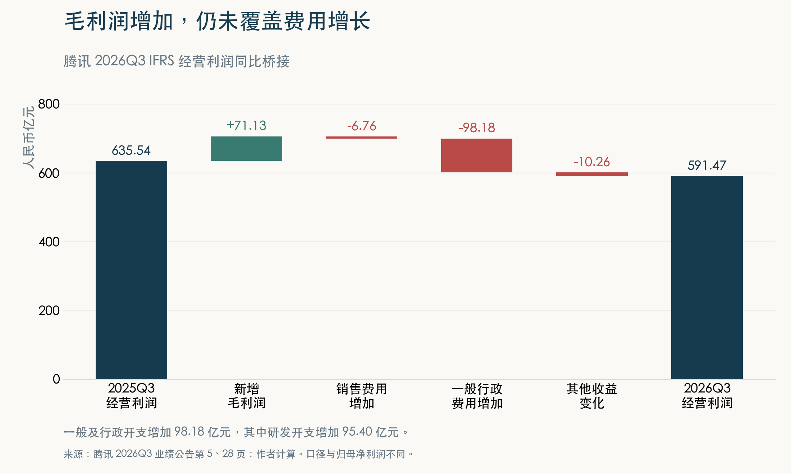
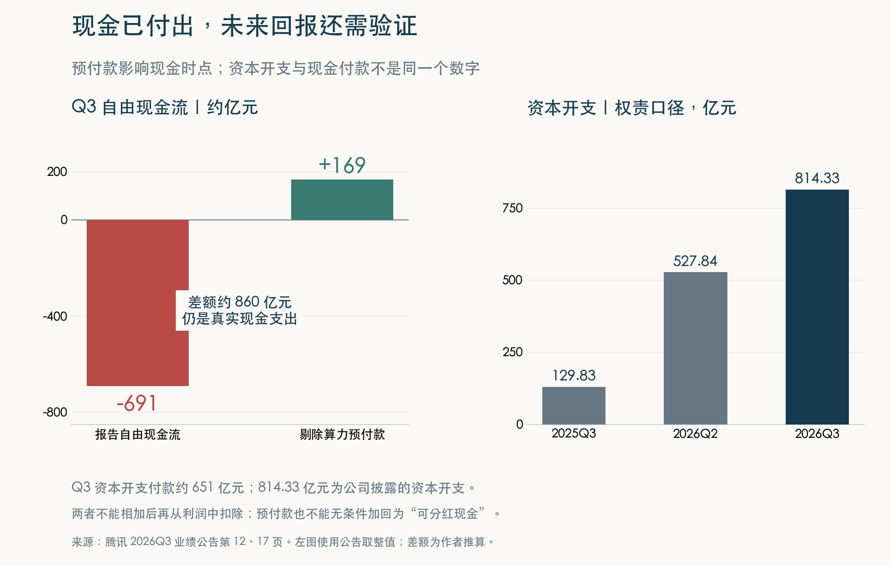

# 腾讯控股（0700.HK）2026Q3 财报研究报告

> 研究与资料截止：2026-11-18，北京时间，三季报公告发布后、当日 20:00 电话会前。财务期间为 2026 年 7–9 月，资产负债表日为 9 月 30 日；“近期”产品进展可能延伸至 11 月。
>
> 行情锚点：11 月 18 日收盘 372.80 港元；按 10 月末已发行股本计算，市值约 3.390 万亿港元、折合 2.880 万亿元人民币。该收盘价早于财报发布，不能解释为市场对本季业绩的反应。
>
> 估值观察：滚动十二个月调整归母利润对应约10.77倍市盈率；本季简单年化约10.8倍，不能当成全年预测。
>
> 一句话判断：腾讯的用户和变现能力仍在，但算力投入正在改变利润转成股东现金的速度，低利润倍数尚不足以证明安全边际。

本文采用财报精读流程及研究报告写作规范，依据腾讯完整业绩公告、历史原始公告、事前预测和独立行情数据。报告用于学习与研究，不构成针对个人的投资建议。配套[公众号稿](腾讯-公众号-20261118.md)侧重解释，本文保留口径、证据与估值假设。

## 资料质量与研究偏见

财报原文可得性为 **A 级**：已取得 50 页完整公告，含三张报表、非国际财务报告准则调节表和附注。财务资料未经审计，但经过核数师审阅；审阅不等于年度审计。Q3 电话会尚未举行，以下管理层评价仅针对书面公告，不包含虚构问答。

独立核验覆盖不完整。收入、IFRS 经营利润、IFRS 归母利润、调整归母利润和金科企业服务收入，与金融界独立转录一致；行情有腾讯与东方财富两源，股本另查公司月报。资本开支、现金流、净债务及附注细项截至截稿仍为**公司一手单源**，已按原文与报表勾稽核对，不把官网和港交所托管的同一份公告算成两个独立来源。[1][6][9]

腾讯的信息很丰富，最容易发生的偏差是：先认定“微信不可替代”，再把所有 AI 支出解释为必然高回报的投资。本报告反过来检验三件事：存量业务是否仍能扩大现金利润、资本需求是否变成常态、最终可分配给普通股东的现金是否增加。模型中的未来现金流是研究假设，不是管理层指引。

---

## 一、本季最重要的三个变化

**第一，收入还在增长，利润的经营基础却在变薄。** 收入同比增长 7.50%，毛利增长 6.54%，调整经营利润下降 6.20%。广告收入增长 19%，但毛利率从公司取整口径的 57% 降至 52%；AI 成本已经进入成熟业务，不能把压力全部归为独立新产品的投入。[1，页1、6–8]

**第二，现金流和资产负债表发生实质变化。** 本季报告自由现金流约负 691 亿元，剔除算力预付款后约正 169 亿元，两种口径差约 860 亿元。期末从上季净现金 581.91 亿元转为净债务 137.02 亿元。预付款影响支出时点，但钱已经离开公司账户。[1，页12、17]

**第三，AI 的使用进展快于投资回报的披露。** 云收入增长 35%，WorkBuddy 披露很高的词元消耗量；与此同时，新 AI 产品净拖累约 152 亿元，资本开支达到 814.33 亿元。产品被使用得到更多验证，付费质量、单位毛利和资本回收期仍未得到充分验证。[1，页3、7–8、12]

## 二、核心数据：先分清集团、归母和调整口径

金额均为人民币亿元；EPS 为人民币元。同比与环比由原始百万元数重新计算，故可能与公告整数百分比略有差别。“调整”指公司非国际财务报告准则口径。

| 指标 | 2026Q3 | 2025Q3 | 同比 | 2026Q2 | 环比 |
|---|---:|---:|---:|---:|---:|
| 收入 | 2,073.36 | 1,928.69 | +7.50% | 2,047.85 | +1.25% |
| 毛利 | 1,159.11 | 1,087.98 | +6.54% | 1,184.33 | -2.13% |
| IFRS 经营利润 | 591.47 | 635.54 | -6.93% | 672.76 | -12.08% |
| 调整经营利润 | 680.73 | 725.70 | -6.20% | 756.36 | -10.00% |
| IFRS 归母利润 | 636.12 | 631.33 | +0.76% | 560.22 | +13.55% |
| 调整归母利润 | 665.19 | 705.51 | -5.72% | 684.15 | -2.77% |
| IFRS 基本 EPS | 7.059 | 6.952 | +1.54% | 6.207 | +13.73% |
| IFRS 稀释 EPS | 6.947 | 6.779 | +2.48% | 6.104 | +13.81% |
| 调整基本 EPS | 7.382 | 7.769 | -4.98% | 7.581 | -2.63% |
| 调整稀释 EPS | 7.227 | 7.575 | -4.59% | 7.433 | -2.77% |

来源：[1，页1、14–15、32–33]。本季集团期内盈利为 651.39 亿元，其中归属于腾讯普通股股东的是 636.12 亿元；不能把前者用于普通股市盈率。上一季 579.77 亿元同样是集团盈利，归母实际为 560.22 亿元。

综合毛利率由 56.41% 降至 55.90%，约下降 0.51 个百分点；调整经营利润率由 37.63% 降至 32.83%，约下降 4.79 个百分点。利润率的主要压力出现在毛利以下，但毛利端也已出现损耗。

### 财报是否超预期

**总评：本报告将本季判为偏低于所能核验的事前预期，主要落在经营利润与资本需求；调整归母利润本身并非显著低于预期。** 这不是拿同比下降冒充预期落空。

| 事前参照 | 预测 | 实际 | 可以得出的结论 |
|---|---:|---:|---|
| 智通财经 11 月 17 日综合预测，收入 | 2,102.40 亿元 | 2,073.36 亿元 | 低约 1.38%，轻微低于该综合预测 |
| 东方日报 11 月 17 日引用的综合预测，调整归母 | 665 亿元 | 665.19 亿元 | 基本相符；原报道未给调查样本 |
| UOB Kay Hian 10 月 29 日预测，调整经营利润 | 731 亿元 | 680.73 亿元 | 低约 6.88%，仅相对该机构 |
| 智通转述野村预测，资本开支 | 587 亿元 | 814.33 亿元 | 高约 38.73%，不能说是高于全市场一致预期 |
| UOB 预测，云收入增速 | +23% | +35% | 高于该机构预期 |

来源：[7][8][10]。公司没有发布可用来核对上述数值的正式季度收入或利润指引，因此“管理层指引是否达标”不适用。两家媒体的综合预测也不是两套可直接合并的调查。

---

## 三、业务结构：收入来自哪里，新增利润流向哪里

腾讯的生意可以概括为：用户在社交、娱乐和交易场景中持续停留，游戏玩家、广告主、商户和企业客户为虚拟内容、成交机会、支付与算力付费；优势来自场景和关系网络，利润则取决于这些需求的服务成本。

| 分部 | Q3收入 | 收入同比 | Q3毛利 | 毛利同比 | 公司取整毛利率，去年→本季 |
|---|---:|---:|---:|---:|---|
| 增值服务 | 983.26 | +2.57% | 630.17 | +7.49% | 61% → 64% |
| 营销服务 | 430.49 | +18.78% | 225.78 | +9.86% | 57% → 52% |
| 金融科技及企业服务 | 636.55 | +9.42% | 315.51 | +8.01% | 50% → 50% |
| 其他 | 23.06 | -11.07% | -12.35 | 由盈转亏 | 16% → -54% |
| **集团** | **2,073.36** | **+7.50%** | **1,159.11** | **+6.54%** | **56% → 56%** |

来源：[1，页6–7、26–27]。毛利率取整会掩盖小幅变化；“其他”分部并不等于所有新 AI 产品，不能直接将其毛亏视为 AI 总亏损。

集团新增收入 144.67 亿元，其中广告贡献 68.07 亿元、约占 47%，金科企业服务贡献 54.81 亿元、约占 38%。这两项合计贡献约 85% 的新增收入，但各自的增长质量不同。

### 游戏：国内产品组合有效，海外并非只有汇率问题

本土游戏收入约 476 亿元，同比增长 11%，由《三角洲行动》《无畏契约：源能行动》《王者荣耀》等驱动。多款游戏日活创新高说明腾讯具备延长生命周期的能力，不只依靠单一新游首发。增值服务毛利率上升，则说明高毛利自研游戏占比带来实际收益。[1，页4、6–7]

国际游戏收入约 189 亿元，人民币口径下降 9%，固定汇率仍下降 4%。去年 Supercell 部分游戏表现和《消逝的光芒：困兽》上线造成高基数，可以解释一部分变化，却不能把全部下降归咎于人民币升值。后续要检验流水和活跃用户能否穿越高基数。

社交网络收入约 318 亿元，同比下降 1%；收费增值服务订阅会员数为 2.53 亿，同比下降 5%。微信及 WeChat 合并月活账户为 14.49 亿，仍增长约 2%。因此，“流量平台仍稳固”与“所有订阅业务都在增长”是两件不同的事。[1，页3、6]

### 广告：收入改善已经兑现，成本改善尚未兑现

公司认为 AI 推荐、广告自动插入和闭环营销促进了广告变现，视频号用户总时长同比增长超过 20%。这些进展支持广告增长并非纯粹加价。[1，页4、6]

但广告新增收入 68.07 亿元只对应新增毛利 20.27 亿元，增量毛利率约 29.8%，显著低于整个分部当前约 52.4% 的毛利率。这个增量比率同时受业务结构和成本时点影响，**不是广告业务永久的单位毛利率**，却足以否定“新增广告收入大部分都会自动变成利润”的推断。

公司明确指出 AI 运营成本和短剧内容成本导致毛利率下滑。这意味着 AI 技术带来的转化改善，并未让广告整体毛利率同步上升；AI 运营和短剧内容是两类不同成本，公司没有分别量化它们的影响，也未单列广告推理费用。真正要追踪的是每单位流量创造的毛利，而不只是点击率或投放金额。即使未来收入增速跑赢同业，也不自动等于股东回报提高。

### 金科与云：增长加速，资本回报仍不透明

金融科技及企业服务收入增长 9%，其中云收入增长 35%；金融科技的增长包括消费贷款与理财服务，企业服务受 AI 需求和国际扩张驱动。集团增加模型即服务与 GPU 租赁的算力分配，为收入恢复提供供给。[1，页3、7]

分部毛利率同比约持平，环比却由约 52% 降至 50%。云并未单独披露收入绝对额、毛利或资本投入回报，不能用整个分部约 50% 的毛利率代替云毛利率，更不能给 GPU 租赁直接套用纯软件估值。租赁收入是否有长期合约、闲置率如何、设备折旧是否与客户付费匹配，才决定这轮增长值多少钱。

---

## 四、利润质量：把变化桥接出来

按 IFRS 经营利润桥接，去年 635.54 亿元，加上新增毛利 71.13 亿元，减去销售费用增加 6.76 亿元、一般及行政开支增加 98.18 亿元，以及其他收益变化减少 10.26 亿元，得到本季 591.47 亿元。[1，页5]

一般及行政开支的增加几乎全部对应研发开支增长：研发由 228.22 亿元升至 323.62 亿元，增加 95.40 亿元。剔除研发的一般行政开支仅增长约 2%。其中研发员工福利开支仅由167.20亿元升至169.63亿元，新增研发支出绝大部分来自非人员项目，但公告没有将这部分全部归因为GPU采购。因此，这次不是所有后台成本同时失控，而是研发与算力相关投入对利润形成集中压力。[1，页8、28]

按性质看，技术基础设施运营成本（不含折旧）由 86.23 亿元升至 199.91 亿元，同比增长约 131.8%；物业、设备及器材、投资物业以及使用权资产折旧由 88.08 亿元升至 137.01 亿元，增长约 55.6%。这些项目分别分配在成本和费用中，**不能再与研发、一般行政费用相加，构造一个重复计算的“总 AI 投入”**。[1，页28]

### “剔除新 AI 产品后增长 8%”应该怎样读

公司披露剔除 Hy、元宝、CodeBuddy、WorkBuddy 和小微等新 AI 产品后，调整经营利润约为 833 亿元，同比增长 8%、环比下降 3%。与含新产品的 680.73 亿元相比，净拖累约 152 亿元；上季相应净拖累约 105 亿元。由于 833 亿元是取整披露，差额只应写近似值。[1，页8、11；2]

这个指标有分析价值：原有业务没有整体坍塌。但它不是集团“完全不做 AI 时”的真实反事实利润，原因有三：原有广告业务内也有 AI 成本；被剔除的是产品收入与费用的净贡献，而非一笔纯费用；如果停止投入会损害现有业务，则这些支出可能兼具防御性，不能假设取消后收入不受影响。

### 为什么 IFRS 归母仍增长，而调整归母下降

本季“投资收益及其他”达 100.57 亿元，去年为 28.20 亿元。其中以公允价值计入损益的金融资产，本季收益 72.16 亿元，去年亏损 52.34 亿元。公允价值变动不能当作同额现金到账。分占联营合营公司利润则从 78.54 亿元降至 44.82 亿元，部分抵消上述顺风；税务变化也支持了本季净利润。[1，页5、8、29–32]

非 IFRS 归母调节表从 636.12 亿元出发，加回股份酬金 78.34 亿元、收购无形资产摊销 31.23 亿元等，同时扣除投资相关收益 87.80 亿元及税务影响等，得到 665.19 亿元。78.34亿元是包含归属权益及投资公司相关调整后的归母调节数，与集团费用中的71.15亿元口径不同。非 IFRS 数字更适合观察经调整经营趋势，但加回股份支付不代表员工成本消失；它会以稀释、回购抵消稀释或现金替代形式影响股东。[1，页14]

---

## 五、现金流：利润便宜，不等于现金便宜

### 先把四种口径分开

| 项目 | Q3金额 | 含义 |
|---|---:|---|
| 经营活动净现金流 | 26.52 亿元 | 前三季累计减上半年累计；包括大额算力预付款 |
| 公司资本开支 | 814.33 亿元 | 权责口径，主要为设备、基础设施等，不等于本季现金付款 |
| 资本开支付款 | 约 651 亿元 | 公司自由现金流计算中实际扣除的付款 |
| 公司报告自由现金流 | 约 -691 亿元 | 还扣除媒体内容付款约46亿元、租赁付款约20亿元 |
| 剔除算力采购预付款的自由现金流 | 约 +169 亿元 | 用于观察付款时点影响，不是本季实际可支配现金 |

来源：[1，页12、17、24；2，现金流表]，资本开支、FCF细项为公司一手单源。使用公告取整数可桥接为：经营现金流约 26 亿元，减资本开支付款约 651 亿元、媒体内容约 46 亿元和租赁付款约 20 亿元，得到约负 691 亿元。不能用精确 OCF 配合全部取整付款，制造不足 1 亿元的“报表对不上”。

最简定义“经营现金流减资本开支”必须使用同一现金口径：本季按 26.52 减约 651，得到约负 624.5 亿元，尚未扣媒体内容与租赁；直接减 814.33 亿元则把权责口径与现金口径混在一起。腾讯披露的自由现金流比这个简式更完整。

本季经营现金流约为集团净利润的 4.1%。前三季累计经营现金流 1,567.13 亿元，低于集团净利润 1,825.08 亿元。原因之一是提前采购算力，而不是已经证明收入虚增；但对于股东，资金占用的结果一样真实。

### 为什么加回预付款有用，却不能据此宣布问题消失

报告 FCF 与剔预付款 FCF 的差约 860 亿元，是根据公司两项取整披露推算的影响额，不是已经取得完整明细的“纯 AI 芯片预付款”。公司称算力同时服务模型、WorkBuddy、其他产品及外部云客户。[1，页17]

预付款换成设备或服务之后，不应在未来现金流中再次扣除已付部分，这是正常的时点调整。但它也可能带来折旧、维护、能耗和新一轮更新需求。股东最终需要的是全周期净现金回报，不是每季都把新的预付款加回。

更值得警惕的是，上季剔预付款后 FCF 约 376 亿元，本季只剩约 169 亿元，环比减少约 207 亿元。即使按公司自己的剔除口径，现金产出也在下降。季节性和投资时点会影响环比，不能据一个季度断言永久恶化，但也不能把所有压力归于预付款。[1][2][11]

维护性与扩张性资本开支没有可靠拆分。将全部新增设备视为扩张性支出并加回，会低估维持竞争力所需的再投资；将 814.33 亿元机械乘四当作永久资本需求，同样会高估支出。合理做法是跟踪未来几个季度设备交付、折旧、利用率和付款节奏。

### 五季度趋势

下表采用原公告；金额为人民币亿元，FCF 是公司披露的取整值，季度 OCF 必要时由累计数相减。完整来源与计算见研究底稿。

| 指标 | 2025Q3 | 2025Q4 | 2026Q1 | 2026Q2 | 2026Q3 |
|---|---:|---:|---:|---:|---:|
| 收入 | 1,928.69 | 1,943.71 | 1,964.58 | 2,047.85 | 2,073.36 |
| 收入同比（公司取整） | +15% | +13% | +9% | +11% | +8% |
| 调整归母利润 | 705.51 | 646.94 | 679.05 | 684.15 | 665.19 |
| 经营现金流 | 853.12 | 664.75 | 1,013.51 | 527.10 | 26.52 |
| 资本开支（权责） | 129.83 | 196.32 | 319.36 | 527.84 | 814.33 |
| 资本开支付款（约） | 200.00 | 224.00 | 370.00 | 593.00 | 651.00 |
| 公司FCF（约） | 585.00 | 340.00 | 567.00 | -138.00 | -691.00 |
| 净现金／负数为净债务 | 1,024.22 | 1,071.45 | 1,468.60 | 581.91 | -137.02 |
| 调整经营利润率 | 37.63% | 35.77% | 38.50% | 36.93% | 32.83% |
| 资本开支／收入 | 6.73% | 10.10% | 16.26% | 25.78% | 39.28% |

来源：[1]–[5]；季度资本开支与付款属于不同口径。2025Q4经营现金流以全年减前三季计算，其余差额计算与原始取数见底稿。

2026年前三季公司FCF合计约负262亿元；滚动十二个月约78亿元，对当前市值仅约0.27%。同期滚动调整归母利润为2,675.33亿元，对应约10.77倍；滚动IFRS归母为2,359.87亿元，对应约12.20倍。低利润倍数与低现金回报同时存在，这比单个同比数字更能解释当前分歧。

趋势的主线是：资本开支上台阶，真实自由现金流连续两个季度为负，资产负债表由现金积累转向融资支持。不能仅凭全年收入增长或调整利润仍高，延续过去的现金回报假设。

---

## 六、资产负债表与附注：缓冲仍在，使用方式已变

### 净债务不等于没有流动性

9 月末现金及等价物为 2,317.17 亿元，定期存款及其他资金管理资产为 2,940.10 亿元，合计 5,257.27 亿元；借款 3,801.01 亿元，应付票据 1,593.28 亿元，合计有息债务 5,394.29 亿元，差额为净债务 137.02 亿元。[1，页17]

这是净现金缓冲减弱，不是现金耗尽。流动资产 7,081.44 亿元、流动负债 5,434.16 亿元，流动比率约 1.30；流动负债包括递延收入，并非全部需要立刻偿还的借款。但公司净现金定义不含租赁负债；若将租赁负债 202.10 亿元也计入，扩大口径的净债务约 339.12 亿元。[1，页20–21]

上市投资权益公允价值约 5,054 亿元、非上市投资权益账面价值约 3,972 亿元，为财务弹性提供支持。它们不是同额即期现金，且可能存在税费、处置折价、控制权与流动性限制。把全部投资资产加到已含联营利润的整体利润估值上，会重复计值。[1，页17]

### 五个值得继续追踪的附注信号

| 项目 | 本季证据 | 判断与边界 |
|---|---|---|
| 预付款和其他资产 | 流动及非流动合计较年末增加1,875.60亿元 | 资本占用显著增加，但该科目不全是算力，不能逐元归因AI |
| 应收账款 | 总额500.62亿元，年末499.30亿元；90天以上48.62亿元，年末34.96亿元 | 总额稳定，长账龄部分却增加约39.1%；占比由7.0%升至9.7%，需追踪回收 |
| 应付账款 | 1,991.76亿元，年末1,211.27亿元 | 供应商信用也在支持资金周转；未披露足够细节，不能全部指认为服务器款 |
| 开发支出资本化 | 附注明确没有重大开发开支资本化 | 当前证据不支持“靠研发资本化美化利润”的指控 |
| 收购与无形资产 | 前三季累计音频公司收购确认约92亿元商誉（Q2已披露）；无形资产科目总额1,999.93亿元 | 协同收益需兑现；季度未单列集团商誉完整余额，不另报伪精确商誉占比 |

来源：[1，页20、28、37、39、43]。无形资产科目占总资产约 8.52%，其中包含何种具体资产应结合年度附注，不能将 92 亿元新增商誉误当集团全部商誉。

应收周转方面，用年初与 9 月末平均应收除以前三季收入、乘 273 天，得到约 22.4 天；这是研究估算，不是公司披露周转率。由于缺少同期起始余额的一致验证，本报告不声称其同比改善。存货仅 7.27 亿元，而集团收入成本包含大量非存货服务成本，机械计算“全集团存货周转天数”缺乏业务解释力。

季度公告没有提供完整的主要供应商集中度、采购承诺和关联交易专项明细；这些项目属于**披露不足**，不是“已经证明不存在”。需结合年度/中期报告及随后电话会继续检验。会计政策说明没有提示本期发生重大政策变化，也未披露以延长折旧寿命提高利润的本季变更，不能自行推定存在或不存在未披露风险。[1，页25]

### 股份支付与回购要放在一起看

Q3 回购 1,586.76 万股，总代价约 70.32 亿港元，平均约 443.18 港元；不能因随后股价低于回购价就断言资本配置失败，但也不能把任何回购都当作增厚价值。同期集团股份酬金为 71.15 亿元人民币，和港币回购额必须先统一币种才能比较。[1，页28–29、44]

每股基本盈利采用加权平均 90.11 亿股，稀释分母为 91.25 亿股，两者都不是用于当日市值的期末股本。10 月月报已发行股本为 90.92644829 亿股，另有已回购待注销股份；本报告按行情一致口径计算市值，未假设未来继续净回购。[1，页32–33；9]

本年前三季已支付每股 5.30 港元的上年度末期股息，合计约 479 亿港元；本季没有新宣派中期股息。按当前股价算，过去这次年度每股股息对应约 1.42% 收益率，不是公司承诺未来每年不变。[1，页33]

10 月公司另发行 18 亿美元及 260 亿元人民币票据，这是季后融资，不应倒填进 9 月末现金。公告同时披露货币利率掉期，不能拿美元票面利率直接代表集团实际融资成本。[1，页43]

---

## 七、护城河和管理层：优势未破裂，资本纪律需要新证据

| 护城河来源 | 本季支持证据 | 可能削弱它的变化 |
|---|---|---|
| 关系网络与交易场景 | 微信月活账户增长、视频号时长增长 | 用户仍用微信，但更多高价值操作和交易被外部AI入口截走 |
| 游戏运营与研发体系 | 本土游戏增长、自研占比改善毛利 | 海外新内容不足、长青产品衰退快于新作补位 |
| 广告数据与闭环转化 | 广告收入增长19% | 推理及内容成本长期快于广告新增毛利 |
| 规模与资金能力 | 巨额流动资金、可处置投资资产 | 投入变成持续必需支出，规模只支持更大支出而非更高回报 |

这些证据强化了“腾讯仍是有竞争力的经营平台”，却削弱了“成熟平台可以用低资本需求稳定分配大部分利润”的旧假设。公司可能以短期现金换取更强竞争地位，是否划算必须看回报。

公告对广告成本、国际游戏下降、负现金流和净债务有直接披露，这是透明度的正面信号。相对不足的是：对 AI 使用量描述具体，对付费用户、单位推理毛利及资本回报尚不充分。管理层说模型能力达到领先水平属于公司判断，本文不据单一榜单作技术能力独立结论。

### 上季表态，哪些兑现了

| Q2表态或方向 | Q3可验证结果 | 评价 |
|---|---|---|
| 增加算力供给、推进云和AI应用 | 云收入增长35%，资本投入上升 | 供给与收入方向得到验证，回报率尚未验证 |
| 根据AI机会动态调整回购 | 本季回购约70亿港元，投入优先级明显上升 | 方向一致，需观察长期每股价值增量 |
| 新AI算力投入主要集中在2026–2027年 | Q3仍处于投入期 | 不是2028必然回落的保证，当前既不能判违约，也不能判兑现 |
| 审慎投入并根据机会调整 | 新AI净拖累从约105亿扩大到约152亿 | 扩大投入需要更强商业回报证据；105亿不是已核实的上限 |

Q2电话会依据第三方整理，可信度低于官方逐字稿；原文没有给集团资本开支硬上限或确定的长期亏损率。[12][13]

### 尚未发生的电话会：应问什么

截至截稿没有可评判的本季分析师 Q&A。今晚最应追问的是：算力预付款交付与消耗时间表；814 亿元资本开支对应哪些资产及使用寿命；广告成本中 AI 与短剧各占多少；新 AI 净拖累扩大由什么驱动；云新增收入的资本回收期；净负债状态下回购与分红如何排序。这些是研究问题，不是管理层已经回答的内容。[14]

---

## 八、最强反方与估值压力测试

### 真正的空头论证

最强反方并非“微信马上消失”，而是：腾讯为了保住原有入口和进入新入口，需要永久增加计算密度与资本支出；收入和调整利润仍可增长，却有更大比例必须反复投入。若如此，原来的低资本需求现金平台估值就需要修正。

| 失败路径 | 主观可能性 | 对价值的影响 | 可观察指标 |
|---|---|---|---|
| 集中投入变成持续高资本需求 | 中高 | 长期股东现金中枢下降 | 2027后资本开支、预付和折旧仍同时高增 |
| AI用量增长但商业化偏弱 | 中 | 推理补贴与获客开支难以收回 | 付费/续费/单位毛利不披露或持续弱于用量 |
| 广告新增毛利不能覆盖服务成本 | 中 | 原有利润引擎减速 | 广告收入增长但毛利率与毛利增速连续恶化 |
| 游戏和宏观需求同时转弱 | 中 | 自有现金不足以覆盖投入 | 本土游戏流水放缓、海外固定汇率持续下降 |
| 监管、算力供给或融资冲击 | 低至中，难量化 | 延迟交付、提高成本或限制变现 | 合规要求、融资利差与设备交付变化 |

概率为研究者的定性判断，不是统计预测，路径也不是互斥事件。最可能的分析错误，是过快把“剔除预付款”和“剔除新AI”都当成永久可加回项目，然后仍给过去的现金流倍数。

### 当前价格究竟便宜在哪里

372.80 港元和 90.9264 亿股，对应 3.3897 万亿港元；使用一港元约 0.849675 元人民币折算，为 2.8802 万亿元。按本季调整归母 665.19 亿元乘四，利润基数约 2,660.76 亿元，倍数约 10.8。[1][9]

但本季剔算力预付款 FCF 169 亿元简单年化只有 676 亿元，相对当前人民币市值约 2.35%。这同样**不是全年预测**，只是说明利润倍数与现金收益之间存在明显距离；而腾讯公司 FCF 是集团口径，也不是已经扣净少数股东与全部经济成本后的普通股现金。

历史比较应比较资本强度和现金转换，而不是只比较同一只股票过去多少倍 PE。当前资本需求已发生变化，把曾经较高的 PE 当作必然回归目标缺乏依据。同样，云、游戏、广告混合后的集团也不宜直接照搬单一软件公司的倍数。本报告不提供未经同口径核验的可比公司估值表。

### 三种股东现金情景

为了把分歧变成可检验的条件，建立一个简化股权现金流模型，先按 **2026 年末**计算，再按各情景折现率折回 **11 月 18 日**，与同日股价比较。两日期间相差43天，假设这段时间新增可分配现金为零。它不是完整 SOTP，也不是未来股价预测。

“股东现金”在此指扣除所有实际再投资、税、利息、少数股东份额及股份支付经济成本后，可归属于普通股股东的持续现金；包含可收到的投资分红，排除依靠持续新增债务或反复出售资产形成的伪持续现金。没有足够披露将它逐项从本季 FCF 精确调整出来，以下直接列为分析假设。

| 情景 | 2027股东现金 | 2028股东现金 | 2029股东现金 | 股权折现率 | 永续增速 | 模型每股值 |
|---|---:|---:|---:|---:|---:|---:|
| 压力 | 600亿元 | 1,200亿元 | 1,500亿元 | 11% | 2% | 约192港元 |
| 基准 | 1,000亿元 | 1,800亿元 | 2,200亿元 | 10% | 3% | 约363港元 |
| 乐观 | 1,600亿元 | 2,400亿元 | 3,000亿元 | 9% | 4% | 约692港元 |

计算方法是折现三年现金，再加上终值的现值。终值等于2029年现金乘以“1＋永续增速”，再除以“股权折现率－永续增速”；终值先折现三年，再与前三年现金一并折回11月18日。全部数据用精确十进制复算，完整输入保存在底稿。表中估值已经包含股东未来可分配现金，不再另加股息；没有把回购率作为额外回报重复相加，也没有再加投资组合价值。

模型假设现有债务本金等额续借、利息已扣，没有净新增借款补贴股东分配；如需净偿还本金，应先从现金中扣除。因此不再次机械扣除当前净债务。股份激励经济成本按维持股数所需代价处理，不再同时假设无成本的净缩股。现有投资资产的潜在清算价值未单独计入，故模型不覆盖所有资产出售选项。也没有假设现金不足可以无限借债来补足。

三个情景的主要区别是现金恢复速度。压力情景并不假设主营业务消失，而是高投入长期压低现金转化；基准假设预付款逐步被交付消化、投放趋于稳定，现金在 2029 年恢复至 2,200 亿元；乐观情景要求商业化与成本下降同时兑现。

**模型最脆弱的地方是终值。** 三种情景的终值现值分别约占估值的 83%、86%、89%。因此，192、363、692 港元应被看作假设的结果，不能视为精确目标价；压力情景也不是最坏损失底线。尚未纳入的 2026Q4 现金变动与融资安排会改变结果，若在11月18日这一估值原点另发生需要从股权价值一次性扣除的1,000亿元现金损失，约影响每股 12.9 港元。

固定基准三年现金路径，仅改变折现率与永续增速，仍得到较宽区间：

| 股权折现率 | 永续增长2% | 永续增长3% | 永续增长4% |
|---|---:|---:|---:|
| 9% | 370港元 | 427港元 | 506港元 |
| 10% | 322港元 | 363港元 | 419港元 |
| 11% | 284港元 | 316港元 | 356港元 |

这说明主情景区间不是统计置信区间，20%模型折让也不能消除现金预测错误。

反过来，在基准折现率与长期增长假设下，若 2027、2028 年股东现金分别为 1,000、1,800 亿元，当前市值大致要求 2029 年达到约 **2,264 亿元**。这才是“现在便宜”的实质前提：现金回报需要明显恢复，而不只是利润继续存在。

---

## 九、这份财报改变了什么，投资者该怎样行动

**投资论文影响：削弱现金回报型论文，未破坏微信与游戏竞争力论文；AI商业化论文增加了使用层面证据，尚缺资本回报证据。** 对于认为腾讯可以长期把大部分利润分配给股东的投资者，这份财报必须触发重审。

| 维度 | 本报告判断 |
|---|---|
| 生意质量 | 原有场景、游戏与广告需求仍有价值 |
| 护城河 | 用户网络未破裂，维持竞争力的成本上升 |
| 管理层 | 披露较直接，资本配置回报尚待验证 |
| 风险 | 已从单纯增速问题转向投入强度与现金转化问题 |
| 估值 | 利润倍数低；基准现金恢复情景下接近合理值，安全边际不厚 |
| 下一催化剂 | 本次电话会对现金与承诺的解释，随后季度真实FCF及付费商业化数据 |

以下价格带只是上述简化模型的行动参考，不能脱离经营证据使用：

| 条件 | 空仓者 | 已持有者 |
|---|---|---|
| 当前约373港元，现金恢复尚未验证 | 不因低PE直接重仓；等待现金证据或更低价格 | 能承受投入期波动者可持有，但不把本季当作自动加仓信号 |
| 约290港元以下，且经营论文未进一步恶化 | 相对363港元基准值约有20%模型折让，可考虑分批研究建仓 | 可重新评估增持，但先检查预付、净债务和AI成本是否恶化 |
| 约290–363港元 | 折让有限，以现金恢复证据决定是否参与 | 持有与复核，避免用平均成本代替价值判断 |
| 高于约455港元，而实际现金与基准假设无改善 | 价格已显著超出基准，不宜仅靠估值修复故事追入 | 若仓位偏重或现金回报是原买入理由，可考虑降低敞口 |
| 连续多季剔预付款FCF仍恶化、净债务上升且无法证明付费回报 | 暂停新增，先下调现金假设 | 即使股价便宜，也应减仓或重新立项，而非等回本 |

290 港元约为基准估值的八折；455 港元约比基准高四分之一，是复核线，不是预测股价会到那里。用户个人仓位、成本与流动性需求未知，本文不指定买卖数量。

下一份财报的核验清单应包括：真实 FCF 是否连续改善；预付款新增、交付与消耗能否解释；广告毛利是否重新跟上收入；云收入增量能否对应合理的设备利用率；AI产品是否披露付费、续费和毛利；股份净减少是否仍有意义；净债务是否稳定。任何单一季度改善都应同时检查是否靠延后付款或出售投资取得。

与现金及其他投资机会相比，腾讯提供的不是确定的高股息，而是恢复较高可分配现金的可能性。愿意承担这项不确定性的持有人需要留出时间和仓位空间；只寻求稳定现金回报的人，应降低对这类投入期资产的依赖。

## 十、数据置信度与核验记录

财务公告及行情转录置信度较高，业务因果判断为中等，长期 AI 回报及模型价格置信度较低。理解一份财报的能力，不等于预测公司未来的确定性。

本报告经过 `financial_rigor` 校验、十进制复算，以及 `report_audit` 固定种子抽样24项和定向复核12项；公众号正文因自动提取器识别为零项，另人工列出39项数据逐项核验，再交审计工具判决。全部检查通过，来源覆盖范围随底稿保存。抽检通过仅表示所检数字与来源相符，不代表未披露信息齐全，更不代表估值假设必然实现。对于现金流、资本开支等一手单源项目，保留披露来源限制。

### 主要来源

1. [腾讯2026Q3完整业绩公告](https://www.tencent.com/wp-content/uploads/2026/11/C700_3Qresults.pdf)，重点页1–17、20–44；[港交所同份公告](https://www1.hkexnews.hk/listedco/listconews/sehk/2026/1118/2026111800449_c.pdf)。同一文件两处托管不是独立两源。
2. [腾讯2026Q2完整公告](https://www.tencent.com/wp-content/uploads/2026/08/C700_IRA.pdf)及[官方业绩材料入口](https://www.tencent.com/investors/results/)。
3. [腾讯2026Q1官方公告](https://static.www.tencent.com/uploads/2026/05/13/59cf8219adbb046153f69387479350ac.pdf)。
4. [腾讯2025全年与Q4官方公告](https://static.www.tencent.com/uploads/2026/03/18/f78591955e05a6db4e31e128bdaefefa.pdf)。
5. [腾讯2025Q3官方公告](https://static.www.tencent.com/uploads/2025/11/13/e63656944030f90a5e4c8f1718d8bdd6.pdf)。
6. [金融界11月18日16:36财报转录](https://m.jrj.com.cn/madapter/stock/2026/11/18163659194053.shtml)。
7. [UOB Kay Hian 10月29日事前预测](https://uobkh.com.hk/en/research/company-hk-tencent-holdings-29102026)。
8. [智通财经11月17日前瞻，证券之星转载](https://hk.stockstar.com/IG2026111700008107.shtml)。
9. [腾讯10月证券变动月报](https://www.tencent.com/wp-content/uploads/2026/11/c_THL_monthly-return-October-2026.pdf)；[腾讯行情](https://qt.gtimg.cn/q=hk00700)与[东方财富行情](https://push2.eastmoney.com/api/qt/stock/get?secid=116.00700&fields=f43,f84,f86,f116)；[新浪即期汇率](https://hq.sinajs.cn/list=fx_shkdcny)及[Wise汇率核验](https://wise.com/us/currency-converter/hkd-to-cny-rate/history/18-11-2026)。
10. [东方日报11月17日事前预期报道](https://orientaldaily.on.cc/content/%E7%94%A2%E7%B6%93/odn-20261117-1117_00202_030/%E5%A4%A7%E8%A1%8C%E4%BC%B0%E9%A8%B0%E8%A8%8A%E4%B8%8A%E5%AD%A3%E5%B0%91%E8%B3%BA%E9%80%BE5-)。
11. [IT之家对Q2现金流的独立转录](https://www.ithome.com/0/988/835.htm)。
12. [新浪整理的Q2电话会实录](https://finance.sina.com.cn/roll/2026-08-16/doc-ininpmti7609397.shtml)，第三方整理，不是官方逐字稿。
13. [科创板日报Q2电话会报道](https://api3.cls.cn/share/article/2452777?app=&os=ios&sv=840)。
14. [腾讯官方投资者日历](https://www.tencent.com/investors/investor-kit-calendar/)。

[研究底稿、来源覆盖与复算记录](../../research_notes/腾讯财报-2026Q3-20261118/README.md)。
