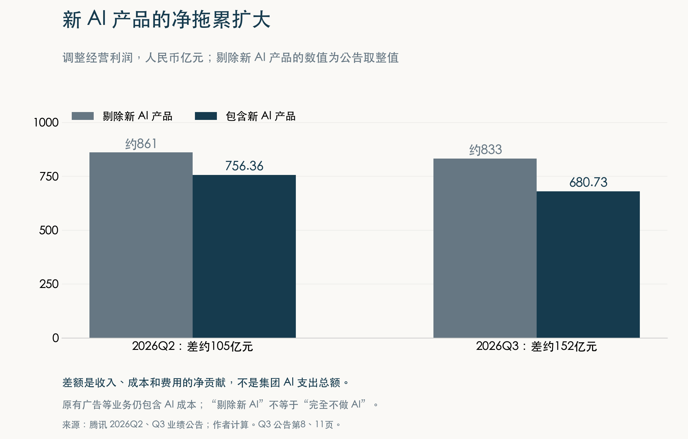
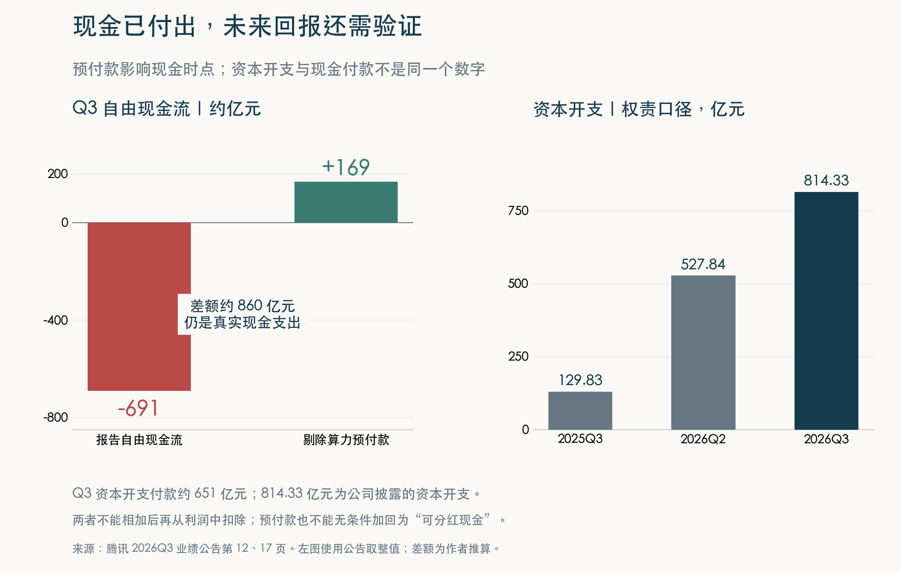

# 腾讯三季报：AI投入正在改写股东回报

腾讯三季度调整后归母利润665亿元，自由现金流却为负691亿元。收入和费用算出来的利润，在扣除实际资本等付款后，没有变成同等规模的股东现金。

两组数字记录的是不同的事情：利润按业务和成本的归属期确认，现金按实际收付记录。腾讯为未来算力提前付款，钱已经离开银行账户，却不必立刻全部成为当季费用。

公司披露，剔除算力采购预付款，自由现金流可以转为正169亿元。两种口径相差约860亿元。这笔钱不能叫“全部烧掉了”，也不能当作“没有花出去”。它换来的是未来资源和服务，能否赚回足够的钱，还需要验证。

**这份财报的核心问题，是腾讯的盈利能力还在，但利润变成股东可分配现金的路，正在变长。**

## 一、游戏和广告还在增长，但增长的质量变了

三季度，腾讯收入2073亿元，同比增长8%；调整后归母利润同比下降6%。收入继续增长，利润开始后退，分歧首先出现在成本端。

游戏基本盘没有失去生命力。本土游戏收入476亿元，同比增长11%，《三角洲行动》《无畏契约：源能行动》和《王者荣耀》继续贡献增长。新产品能延长热度，老产品能持续吸引付费，这是腾讯游戏最有价值的能力。

但海外游戏收入189亿元，同比下降9%；按固定汇率计算，下降4%。汇率解释了一部分压力，去年同期较高的业绩基数也有影响，仍不能把这一块写成毫无波折的增长故事。

更容易被忽视的是广告。营销服务收入增长19%，看起来很强，毛利率却从去年同期的57%降到了52%。公司解释，成本增加来自AI相关运营和短剧内容。

这意味着，广告系统越来越聪明、广告收入持续上升，并不保证每一元收入能留下同样多的利润。推荐更精准要消耗算力，吸引用户要采购或生产内容，效率红利也伴随着新的成本。

判断广告业务，不能只看视频号使用时长和收入增速，还要看这些增长最后留下多少钱。

## 二、约152亿元的AI拖累，应该怎样理解

腾讯披露了两组经营利润：包含新AI产品的调整后经营利润约681亿元；剔除新AI产品影响后，约833亿元。两者相差约152亿元。

这不是腾讯当季全部AI费用。它是剔除一组产品的收入、成本和费用后，经营利润发生的净变化。相关产品主要包括Hy模型、元宝、CodeBuddy、WorkBuddy和小微。

原有业务里的AI成本不会因此全部消失。广告推荐系统仍需要算力，微信和其他服务也在继续建设AI能力。把833亿元称为“完全不受AI影响的利润”，就把边界画错了。

更关键的变化是，剔除新AI产品后的经营利润，本季同比只增长8%，二季度则增长19%。同时，新AI产品带来的净拖累从二季度约105亿元扩大到本季度约152亿元。

因此，利润承压有两层原因：新业务投入加深，原有业务的利润增长也在放缓。前者可以用“提前投资未来”解释，后者提醒我们，支撑投资的现金来源同样需要持续观察。

长期投资者可以接受孵化期。真正需要避免的，是每个季度都把投入加回来，却从不检验投入何时、以什么方式产生回报。

## 三、现金流里，最重要的不是负号本身

这季现金账可以用几个整数说明白：经营活动带来约26亿元现金，资本开支付款约651亿元，媒体内容付款46亿元，租赁负债付款20亿元，最后得到负691亿元自由现金流。

经营现金流很低，主要受大额算力采购预付款影响。腾讯给出的另一种观察方式，是把这类预付款剔除，得到正169亿元自由现金流。

这有助于理解付款时点，但不能取代真实现金账。预付出去的资金，在资源交付和业务回款之前，无法同时拿来分红、回购或投资别的项目。

还有一个不能漏看的比较：二季度剔除算力采购预付款后的自由现金流是376亿元，三季度降至169亿元。即使暂时不考虑预付款的影响，剩下的现金产出也在减少。

财报里的“资本开支814亿元”和现金账里的“资本开支付款651亿元”为什么不同？因为一个按资本投入的确认口径统计，一个按实际付款统计，设备确认、付款和预付的时点可能错开。不能把814亿元直接塞进现金流公式，也不能把所有算力预付款再重复扣一次。

接下来要盯住的，是采购之后的整条链：资源按时交付了吗，利用率够高吗，客户愿意付费吗，收入能覆盖推理成本、折旧和后续更新吗？

只看本季负现金流，就断言腾讯失去了赚钱能力，太仓促；只看剔除预付款后的正数，就宣布现金流没有问题，同样太轻松。

## 四、AI已经有需求，还缺一张回报成绩单

支持腾讯继续投入的证据并非只有愿景。三季度云服务收入同比增长35%，公告也明确提到，WorkBuddy、模型即服务和GPU租赁促进了增长。

不过，金融科技及企业服务整个板块的毛利率仍约为50%。公司没有单独披露云业务的完整利润，也没有把新增算力对应的投入回报逐项列出来。收入加速说明需求在兑现，距离证明投入划算，还有一段路。

财报还更新了WorkBuddy的进展：每日超千万用户，合计消耗超过100万亿词元。它能帮助我们认识使用规模，但这是公告发布时“近月”的业务更新，不能直接当成三季度全季平均数据。

词元是模型处理信息的计量单位。调用更多，可能来自更多付费任务，也可能来自免费额度、更复杂的任务，或者完成同一件事需要更多计算。只有结合收费、成本和续费，才能判断规模增长的经济价值。

同样，11月发布的Hy4属于第四季度的新进展。模型能力提升值得观察，却不能倒填进7月至9月的财务成绩单。

腾讯的优势是拥有微信、游戏和企业客户，可以把技术放进真实场景反复打磨。投资者要等的下一步，是这些场景不仅有人用，而且留下持续、足够高的现金回报。

## 五、从净现金到净负债，改变了什么

六月末，腾讯有约582亿元净现金；九月末，变成约137亿元净债务。这说明，资本投入已经开始消耗过去积累的财务余量。

但净负债不等于没现金。按公司口径，腾讯仍有约5257亿元现金、定期存款及其他资金管理资产，只是借款和应付票据合计更多。把这解读成资金链危机，既不符合资产负债表，也会错过真正的问题。

真正的问题是现金的优先级。三季度公司花了约70亿港元回购股票，二季度约169亿港元。币种与人民币资本开支不同，不能直接相除，但回购力度减弱的方向很清楚。

据二季度电话会的第三方整理，管理层曾表示，如果算力投资提供更好的回报，会把更多现金投向资本开支，并动态调整回购。现在，这个选择正在财务报表里落地。

它可能是正确的长期决策，但投资者不能同时默认“AI投入大幅增加”和“回购持续加码”都能轻松实现。公司也未在本次三季报新增宣布股息，已发放的年度分红不能再算成这季的新承诺。

对于看重稳定分红回购的人，这是一项实质变化；对于愿意承担AI投资周期的人，则需要重新检查自己愿意等待多久、承受多大的回报不确定性。

## 六、约11倍利润，为什么还不能直接说便宜

11月18日，腾讯收盘价为372.8港元，按最新披露的10月末股本和当日即期汇率折算，市值约2.88万亿元人民币。这是财报发布前已形成的收盘价，不能把当天涨跌归因于盘后才公布的业绩。

若简单把三季度665亿元调整后归母利润乘以四，对应约10.8倍市盈率。这只是单季年化的粗略观察，不是过去十二个月市盈率，更不是未来盈利预测。

这个数字确实不高。但买股票最终拥有的，是企业在满足必要投入之后，能够长期留给股东的收益。会计利润不能自动等量变成可分配现金。

如果今天的大额投入主要是建设阶段的集中支出，未来利用率提升、商业化跑通、投入强度回落，那么眼前现金流低谷可能换来更大的长期价值。

如果模型竞争、算力更新和用户补贴需要年复一年维持高投入，利润表看起来便宜，股东能拿到的现金却未必便宜。两条路径都不能只凭本季确认。

所以，“约11倍”是研究的起点。真正决定买入是否划算的，是正常年份能留下多少现金，以及需要等多少年才能到达那个正常年份。

## 七、下一份财报，该等什么答案

对已有持仓的投资者，这季不足以仅凭一个负现金流数字否定腾讯，也不足以仅凭低市盈率机械加仓。需要调整的，是衡量这门生意的尺子。

先看真实自由现金流能否连续改善，而不是每季都依赖剔除一笔更大的预付款。再看采购资源落地后，新增折旧与收入、毛利的关系，确认现金压力没有只是移到了未来利润表。

广告毛利率也很关键。如果收入继续增长，毛利率却迟迟无法稳定，就说明原有业务享受AI收益的同时，必须承担更高的持续成本。

最后看AI产品：能否披露更清楚的付费收入、续费表现和单位成本。用量增长是线索，能够持续收费并覆盖投入，才是生意。

对尚未持有的人，不必为了赶上这份财报立刻下注。可以先确定自己接受的回报要求，再给资本投入、现金流恢复和AI商业化留出足够保守的假设。

腾讯依然拥有有生命力的核心业务。本季需要重新审视的，是这份盈利能力有多少必须继续投入，多少最终能属于股东。

**腾讯接下来最有说服力的AI成绩单，是更强的产品，最终带回更多能留给股东的现金。**

---

资料截至2026年11月18日三季报公告发布后、当晚20:00业绩电话会召开前。本文未包含本季电话会问答。金额除特别注明外为人民币，部分数字为便于阅读取整。

主要原始资料：[腾讯2026Q3业绩公告](https://www.tencent.com/wp-content/uploads/2026/11/C700_3Qresults.pdf)（业务与利润第6–13页、现金流第17页、回购第44页）；[腾讯2026Q2业绩公告及材料入口](https://www.tencent.com/investors/results/)；[腾讯投资者日历](https://www.tencent.com/investors/investor-kit-calendar/)。核心收入与利润经[金融界当日快讯](https://m.jrj.com.cn/madapter/stock/2026/11/18163659194053.shtml)复核；现金流、预付款及分部毛利率等细节以公司公告为单一原始依据。

延伸资料：[Q2电话会第三方整理](https://finance.sina.com.cn/roll/2026-08-16/doc-ininpmti7609397.shtml)；[完整研究报告与估值假设](腾讯-earnings-2026Q3-研究报告-20261118.md)。

本文用于学习与研究，不构成个性化投资建议。
