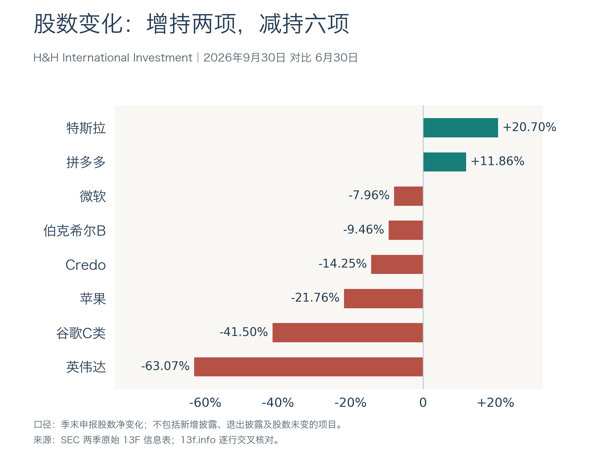
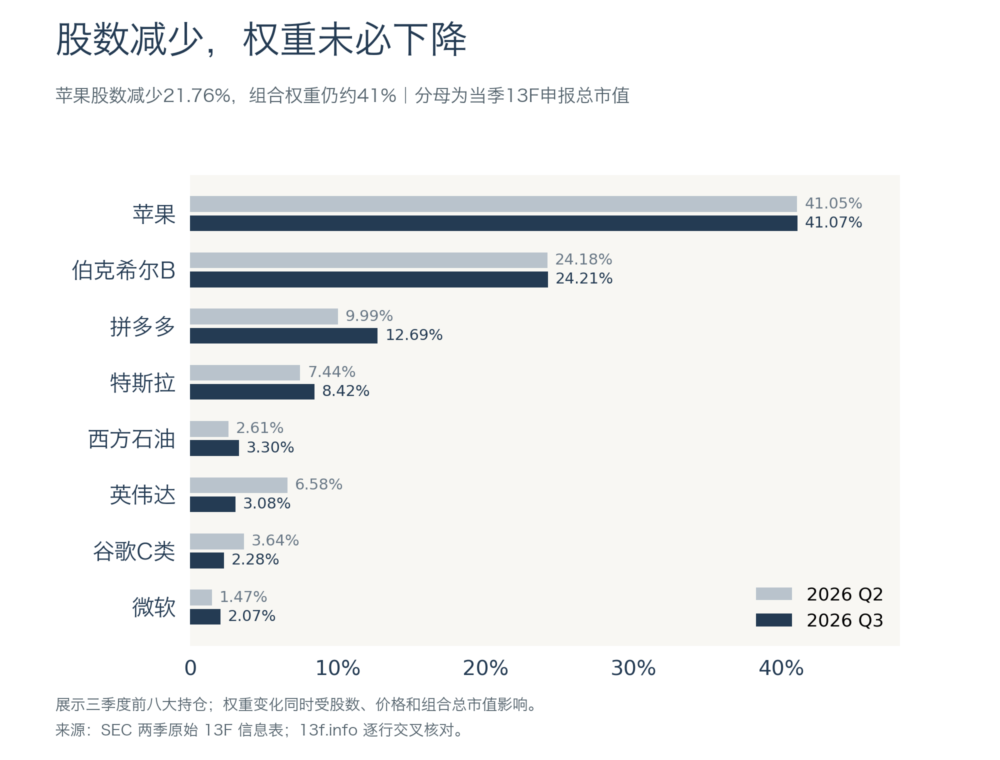

# 段永平三季度持仓：苹果少了两成，谁增加了？

> 数据截止：2026 年 11 月 17 日。比较 H&H International Investment, LLC 截至 2026 年 9 月 30 日与 6 月 30 日的两份 13F；三季度文件于美国当地 11 月 16 日提交。本文“增持、减持”均指两次季末申报股数的净变化，不等同于逐笔买卖记录。

苹果少了近 590 万股，减幅 21.76%，在组合中的占比却几乎没动：从 41.05% 变成 41.07%。

英伟达又少了 396 万股，季末持股减少 63.07%；拼多多增加约 297 万股，特斯拉增加约 70 万股。

这就是段永平相关机构 H&H 最新持仓最值得拆开的地方：**股数在变，权重也在变，但两者有时指向完全不同的方向。**只看“第一重仓仍是苹果”，会漏掉一轮明显调整；只看减持名单，又容易把整个组合想成另一副样子。[1][2]

## 先看全貌：组合少了约一成，不能说亏了一成

三季度末，H&H 披露的证券市值为 171.91 亿美元，上季度为 191.01 亿美元，减少约 19.10 亿美元，降幅约 10.00%。申报条目从 18 项降至 16 项。

这不是季度收益率。

两张持仓表之间，可能发生买卖、资金转入转出以及其他变化，股价也在波动。缺少完整现金流、现金余额和交易时点，就不能从“市值少了一成”推导出“投资亏了一成”，更不能据此算出现在有多少现金。

按季末股数比较，本季是：原有持仓中 2 项增加、6 项减少、7 项不变；另有 1 项新出现在这次两季对照中，3 项上季有、本季未再披露。

这里的对象也需要说清楚。港交所 2026 年 8 月 5 日的一份段永平个人权益表，将 H&H 列为其控制比例为 99% 的法团。但 H&H 的 13F 并不等于段永平全部个人资产清单；文中所有“权重”，分母都是这份 13F 的申报总市值。[5]

把完整资产版图和这张美股证券快照分开，后面的变化才有意义。

## 两个增加、六个减少，先把账摆出来

下表列出仍在两季报告中、股数发生变化的全部八项持仓。拼多多的“股数”按申报的美国存托股（ADS）单位比较，不与港股或普通股数量混用。

| 标的 | 二季度末股数 | 三季度末股数 | 净变化 | 幅度 |
|---|---:|---:|---:|---:|
| 拼多多 | 25,022,094 | 27,990,859 | +2,968,765 | +11.86% |
| 特斯拉 | 3,380,400 | 4,080,000 | +699,600 | +20.70% |
| 苹果 | 27,098,707 | 21,202,403 | -5,896,304 | -21.76% |
| 伯克希尔B | 9,229,696 | 8,356,796 | -872,900 | -9.46% |
| 英伟达 | 6,280,675 | 2,319,475 | -3,961,200 | -63.07% |
| 谷歌C类 | 1,968,600 | 1,151,700 | -816,900 | -41.50% |
| 微软 | 754,100 | 694,100 | -60,000 | -7.96% |
| Credo | 701,200 | 601,300 | -99,900 | -14.25% |

*图：原有持仓中八项股数变化。百分比以二季度末股数为基数；不代表成交金额或资金流。*

先看数量，再看钱，最后才谈解释。13F 能帮助我们确认季末剩下多少股，却不会告诉我们某次减少究竟来自直接卖出、期权交割还是其他安排。

因此，下面讨论的是组合结构的变化。没有直接证据支持的动机，不能替持有人写成答案。

## 苹果少了两成，为什么仍占四成？

苹果持股从约 2,710 万股降至约 2,120 万股，减少 589.63 万股。这不是一个可以忽略的数量变化。

但苹果持仓市值从 78.41 亿美元降至 70.61 亿美元，下降幅度明显小于股数降幅。原因可以直接从申报数据看出来：三季度末的每股估值高于二季度末，抵消了部分股数减少的影响。

与此同时，整个申报组合的市值也缩小了。苹果的分子变小，组合的分母也变小，最终权重停留在 41% 附近。

**“权重基本不变”不代表“没有减持”；“持股减少两成”也不代表“苹果已经不重要”。**三季度末，苹果依然是这份组合中最大的单一持仓。

伯克希尔B也有相似的一面：股数减少 9.46%，权重却从 24.18% 小幅变为 24.21%。两者合计占比，上季度为 65.23%，本季度为 65.28%。

这意味着，尽管多个持仓发生调整，组合的大框架依旧高度集中在苹果和伯克希尔。用一句“全面换仓”概括，会掩盖这件事。

微软则从另一个方向提醒我们：股数减少 7.96%，申报市值却从约 2.81 亿美元增加至 3.56 亿美元，权重由 1.47% 升至 2.07%。如果只比较金额，很容易误判成加仓。

阅读持仓变化，股数、市值、权重三个指标必须放在一起看。

## 拼多多和特斯拉：这次增加发生在哪里

拼多多是本季最值得认真看待的变化之一。

持有的 ADS 增加 296.88 万份，增幅 11.86%；期末市值由 19.09 亿美元升至 21.82 亿美元，权重从 9.99% 升至 12.69%，提高约 2.70 个百分点，仍居第三位。

权重提升的一部分来自整个组合分母缩小，但股数增加是单独成立的事实。它使拼多多在这份集中组合中的分量进一步加重。

特斯拉的变化也不能只看市值。股数增加 20.70%，从 338.04 万股增至 408 万股；持仓市值却只是从 14.22 亿美元增至 14.48 亿美元。

两期申报对应的每股估值下降，抵消了大部分股数增加。结果是，“金额只多了一点”和“持股增加两成”同时成立。其权重由 7.44% 升至 8.42%，仍排第四。

这两项增加，能够支持的结论是：截至三季度末，H&H 披露的拼多多和特斯拉持股数量比上季度更多，在组合里的占比也更高。

它们不能进一步证明持有人用了什么价格买入、预期持有多久，或判断哪家公司当前更便宜。把季度增持直接翻译为“现在可以买”，中间仍缺少一整套估值判断。

从跟踪角度说，我更关心下一期是否延续这种变化，以及拼多多、特斯拉的经营表现能否支持更高的组合权重。这是后续研究的问题，不是这张表已经给出的答案。

## 英伟达降到第六，但不能写成看空所有科技股

英伟达本季股数减少 63.07%，是八项原有持仓增减中，按百分比计幅度最大的一项。

持股从 628.07 万股降至 231.95 万股，期末市值从 12.57 亿美元降至 5.30 亿美元；权重由 6.58% 降至 3.08%，排名从第五退到第六。

谷歌C类同时减少 41.50%，权重由 3.64% 降至 2.28%；Credo减少 14.25%，权重由约 1.00% 降至 0.68%。这些数量变化，确实让几项科技相关持仓在申报表里的分量下降。

但要从这里推导“全面看空科技”，证据不够。苹果仍占四成，特斯拉增加，微软虽然股数减少但仍在表内，Palantir、Snowflake、新思科技和 Tempus AI 的两季末股数也相同。

更准确的观察是：**组合在不同公司之间作了取舍，不能用一个行业口号替代逐项判断。**至于这些取舍是估值、风险控制、资金安排还是其他原因，仅凭 13F 无法定论。

还有一个容易忽略的排名变化：西方石油从第七升至第五，但两季末都是 10,261,500 股。

它的排名上升，来自自身期末估值变化和其他持仓变化的共同作用，并非增持。所谓“新晋前五”，也需要先看股数。

*图：权重均以各季度 13F 总市值为分母。股价变化与持股数量变化都会影响权重。*

## SpaceX新出现，三项未再披露：先看它们有多大

本次两季对照中，新出现的是 SpaceX。SEC 信息表列名为 SPACE EXPLORATION TECHN CORP，CUSIP 为 84615Q103，申报 199,900 股，市值 30,156,914 美元。

这是约 3,016 万美元，占三季度申报组合约 0.18%，排第十二。[1]

名称很吸引眼球，仓位却需要按比例理解。它并非这份组合的主要部分；“本季表中新出现”，也不能延伸成“段永平人生第一次买入”。申报表没有给出这类历史信息。

上季出现、本季未再披露的则有三项：阿里巴巴 ADS，上季为 301,400 份；Circle，上季为 200,000 股；Innodata，上季为 10,000 股。

这里保留“未再披露”的措辞。13F 对同时低于一万股且市值低于二十万美元的小额持仓允许省略，单凭条目消失，不能绝对确认真实持股一股不剩。[4]

再看七项股数没有变化的持仓：西方石油、迪士尼、联合健康、Palantir、Snowflake、新思科技和 Tempus AI。

“两季末相同”也不等于“整个季度从未交易”。季度报告只拍两张照片，拍照之间发生过什么，需要其他证据。

## 名单有16项，真正决定组合的仍是少数几项

三季度末全部已披露持仓如下，按市值排列。市值以亿美元表示并四舍五入；精确股数和美元值保留在原始资料中。

| 标的 | 市值（亿美元） | 组合权重 |
|---|---:|---:|
| 苹果 | 70.608 | 41.07% |
| 伯克希尔B | 41.613 | 24.21% |
| 拼多多 | 21.816 | 12.69% |
| 特斯拉 | 14.476 | 8.42% |
| 西方石油 | 5.677 | 3.30% |
| 英伟达 | 5.297 | 3.08% |
| 谷歌C类 | 3.924 | 2.28% |
| 微软 | 3.560 | 2.07% |
| 迪士尼 | 1.790 | 1.04% |
| 联合健康 | 1.467 | 0.85% |
| Credo | 1.171 | 0.68% |
| SpaceX | 0.302 | 0.18% |
| Palantir | 0.112 | 0.07% |
| 新思科技 | 0.043 | 0.03% |
| Snowflake | 0.034 | 0.02% |
| Tempus AI | 0.016 | 0.01% |

前五大持仓合计占 89.69%，前十大占 99.02%。因此，分析精力应该和仓位分量相称。研究苹果、伯克希尔和拼多多，比围绕一个新出现的小仓位编故事，更接近这份组合的实际风险与回报来源。

把这份表拿来检查自己的阅读习惯，还可以问三个问题。

第一，我看到的“看好程度”，来自股数增加，还是单纯来自股价上涨？微软提醒我们，两者不能混用；西方石油则说明，排名上升甚至不需要增加一股。

第二，我关注的新闻，和它在组合中的分量是否相称？一个新名字容易成为标题，但决定组合表现的，仍然是那些占据大部分资金的旧名字。小仓位即使增长很快，也需要和整个组合放在一起看。

第三，我准备跟随的是哪一部分风险？买入一只相同的股票，并不会自动得到相同的资产配置、现金储备、持有期限与承受能力。特别是在这类集中组合里，真正困难的是持有大仓位时怎样理解业务、处理波动，这些无法从一张季度清单里复制。

最后还要留意一块看不见的部分：两份信息表均没有列出期权条目，但 SEC 规定，卖出的看涨、看跌期权不在 13F 中申报。没有期权行，并不能证明没有期权策略。[4]

截至三季度末，能确认的主线已经足够清楚：苹果、伯克希尔仍构成约三分之二的组合；拼多多与特斯拉股数增加；英伟达、谷歌等持股减少。资金最终去了哪里、每笔变化因何发生，仍需更多材料。

这份持仓最有用的地方，是帮助我们提出更好的研究问题，而不是替我们省掉判断。

**看懂一份持仓，先看股数怎么变，再看它在组合里有多重。**

---

*本文用于学习与研究，不构成投资建议。数据反映 2026 年 9 月底的申报快照，不代表当前实时持仓。*

**数据与核验说明**：本文从两份 SEC 原始 XML 按证券识别码、证券类别及期权属性匹配，分别核对条目数与封面总额。再与独立托管的 13f.info 转录表逐行比对，两季共 34 行股数全部一致；该网站市值按千美元截断，每行与 SEC 的差额均小于 1,000 美元。转录网站的底层来源也是 SEC，此核验用于检查提取与计算，不代表对真实资产的独立审计。文中增减幅度、权重与合计均重新计算。[1][2][3]

**资料来源**

1. [H&H 2026Q3 SEC 原始完整申报](https://www.sec.gov/Archives/edgar/data/1759760/000175976026000008/0001759760-26-000008.txt)，报告期 2026-09-30。
2. [H&H 2026Q2 SEC 原始完整申报](https://www.sec.gov/Archives/edgar/data/1759760/000175976026000007/0001759760-26-000007.txt)，报告期 2026-06-30。
3. 13f.info 独立托管转录：[2026Q3](https://13f.info/13f/000175976026000008-h-h-international-investment-llc-q3-2026)、[2026Q2](https://13f.info/13f/000175976026000007-h-h-international-investment-llc-q2-2026)。
4. [SEC Form 13F 常见问题](https://www.sec.gov/rules-regulations/staff-guidance/frequently-asked-questions-about-form-13f)，小额持仓省略规则及卖出期权的申报边界。
5. [港交所段永平个人权益披露，IS20260805E00004](https://di.hkex.com.hk/di/NSForm1.aspx?fn=IS20260805E00004&lang=ZH)，第 20 项 H&H 控制关系，提交日期 2026-08-05。
